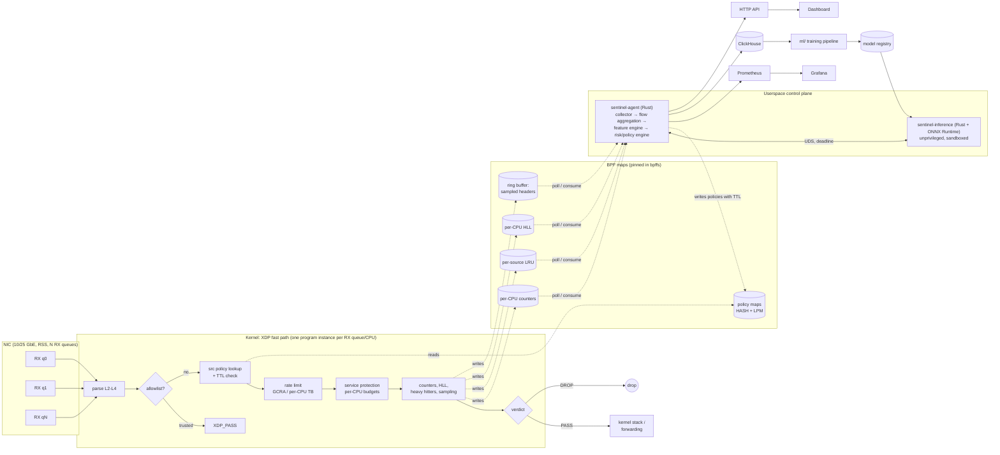
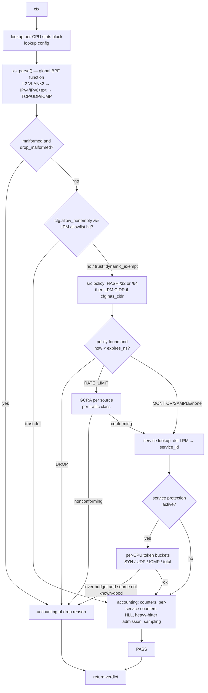
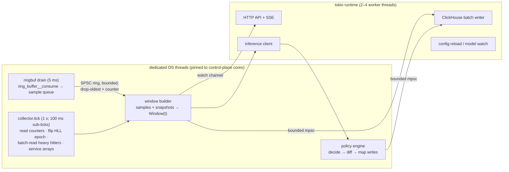

<!-- Sprog: **Dansk** · [English](../EN/architecture.md) -->

# xdp-sentinel-arkitektur

Dette dokument er reference-designet. Sektioner mapper til de ønskede
leverancer:

| Sektion | Emne | Se også |
|---|---|---|
| A | [Arkitektur-overblik](#a-arkitektur-overblik) | |
| B | [Teknologi-stak](#b-teknologi-stak) | |
| E | [Repository-struktur](#e-repository-struktur) | |
| F | [XDP-dataplan-design](#f-xdp-dataplan-design) | [bpf-maps.md](bpf-maps.md) (G) |
| H | [Rust-userspace-arkitektur](#h-rust-userspace-arkitektur) | |
| — | [Control-plane-API](#api-design) | |
| — | [Fejltilstande og sikre standardvalg](#fejltilstande-og-sikre-standardvalg) | |
| C, D | Hardware, CPU/NUMA/RSS | [hardware-tuning.md](hardware-tuning.md) |
| I | Feature-schema, flow-nøgle | [feature-schema.md](feature-schema.md) |
| J | ML-arkitektur, træning, deployment | [ml.md](ml.md) |
| K | Risiko/policy-motor, rate limiting, falsk-positiv-kontrol | [policy-engine.md](policy-engine.md) |
| L | ClickHouse-schema | [storage.md](storage.md) |
| M, N | Metrics, alarmer, dashboard | [observability.md](observability.md) |
| O | Trusselsmodel | [threat-model.md](threat-model.md) |
| P | Benchmark-metodik | [performance.md](performance.md) |
| Q | Roadmap, build, test | [development.md](development.md) |

---

## A. Arkitektur-overblik

### Den ene regel

**Pakke-stien venter aldrig på noget.** Hver per-pakke-beslutning træffes af
XDP-programmet ud fra state der allerede er i BPF maps. Alt dyrt (aggregering,
feature-ekstraktion, ML, policy-ræsonnement, lagring) kører asynkront i userspace
og påvirker kun pakke-stien ved at skrive map-entries der bærer deres egen
udløbstid. Hvis hele userspace forsvinder, bliver dataplanet ved med at forwarde
og håndhæve de deterministiske politikker det allerede holder, og de politikker
udløber efter planen.

### Planes



### Dataflow og timing

```mermaid
sequenceDiagram
    participant X as XDP (per packet, ~100 ns budget)
    participant M as BPF maps
    participant C as collector (1 s tick)
    participant F as feature engine
    participant I as inference
    participant P as policy engine
    X->>M: counters / HLL / heavy-hitter updates (every packet)
    X->>M: ringbuf sample (1-in-N, per-CPU capped)
    C->>M: read per-CPU counters, flip HLL epoch, batch-read heavy hitters
    C->>C: drain ring buffer continuously (5 ms poll)
    C->>F: window W(t) (global, per-service, per-source)
    F->>I: feature batch + schema hash (deadline 200 ms)
    I-->>F: scores (or timeout → deterministic only)
    F->>P: features + scores + rule evidence
    P->>M: upsert / delete policies (expires_ns set on every entry)
    Note over X,M: policies take effect on the next packet;<br/>expired entries are ignored by XDP even if never deleted
```

Mål for end-to-end-reaktionstid: **angrebs-onset → første mitigering ≤ 3 s** for
volumetriske angreb (1 s-vinduer, 2–3 fortløbende vinduer af evidens), **≤ 1
pakke** for alt der allerede er dækket af en statisk regel eller en eksisterende
politik.

### Deployment-topologier

Det samme dataplan understøtter tre topologier; Fase 1–16 målretter de første to.

| Mode | Hvor XDP kører | Legitim trafik | Brug |
|---|---|---|---|
| `host` | NIC på den beskyttede server | `XDP_PASS` til lokal stak | Beskyt tjenester på denne maskine |
| `inline` | Ydre NIC på en Linux-router/bridge | `XDP_PASS` til kerne-forwarding (valgfrit `bpf_fib_lookup` + `XDP_REDIRECT` fast-forwarding, se F.3) | Scrubbing-boks foran et netværk |
| `tap` | NIC der modtager en mirror/TAP | altid `XDP_DROP` efter telemetri | Kun detektion; mitigering eksporteret (f.eks. BGP FlowSpec) — kun design-hook |

---

## B. Teknologi-stak

Eksakte valg med begrundelsen for hvert. Versioner er minimumskrav som koden
testes mod; nyere er fint.

### Dataplan

| Komponent | Valg | Hvorfor |
|---|---|---|
| Kerne | Linux ≥ 6.1 LTS; anbefalet 6.6 LTS / 6.12 LTS | 6.1 giver BTF, bounded loops (5.3), ringbuf (5.8), atomic fetch ops (5.12), `bpf_xdp_get_buff_len` (5.18), XDP multi-buffer (5.18). Debian 12/13, Ubuntu 22.04 HWE/24.04, RHEL 9.4+ (backports) kvalificerer. |
| Sprog | C (GNU11) | Eneste mainstream, fuldt understøttede sprog til BPF med libbpf; verifier-adfærd af clang-output er velforstået. |
| Compiler | clang/LLVM ≥ 16 (CI: 19), `-target bpf -mcpu=v3 -O2 -g` | v3 = ALU32/JMP32/atomics, færre instruktioner, loads på ≥ 5.12. `-g` producerer BTF. |
| Loader-bibliotek | libbpf ≥ 1.1 (C-tests; CI: 1.5), libbpf-rs 0.27 (vendoret libbpf 1.7) | Reference-implementation af BTF-maps, pinning-semantik, CO-RE. |
| BTF / CO-RE | `vmlinux.h` fra `bpftool btf dump`, BTF-definerede maps | Se note nedenfor. |
| Tooling | bpftool ≥ 7 | vmlinux.h-generering, introspektion, `prog loadall` til verifier-tjek. |

**Om CO-RE for XDP, ærligt:** CO-RE-relokationer betyder noget når et BPF-program
læser *kerne*-strukturer hvis layout ændrer sig mellem kerner (tracing). Et
XDP-program læser *pakke*-bytes hvis layout er fastlagt af RFC'er, plus
`struct xdp_md`, som er UAPI. Så XDP-programmet indeholder ingen
CO-RE-felt-relokationer og behøver dem ikke. Hvad vi bruger fra BTF/CO-RE-
toolchainen: (1) BTF-definerede maps (typede keys/values: `bpftool map dump`
pretty-printer dem og libbpf validerer pinned-map-kompatibilitet), (2) globale
BPF-funktioner, som kræver BTF, og (3) `vmlinux.h`, som fjerner
build-afhængigheden af installerede kerne-headers. Objektet bygget på én kerne
loader på enhver ≥ 6.1-kerne uden rekompilering.

### Userspace

| Komponent | Valg | Hvorfor |
|---|---|---|
| Sprog | Rust (edition 2021, MSRV 1.85) | Hukommelsessikkerhed for en privilegeret dæmon der parser angriber-påvirket data; forudsigelig latency (ingen GC). |
| BPF-bibliotek | **libbpf-rs 0.27** | Se valg nedenfor. |
| Async-runtime | tokio (multi-thread), kun til netværks-I/O: HTTP-API, SSE, ClickHouse-writer, inferens-IPC | Map-polling, ring-buffer-draining og aggregering kører på dedikerede, core-pinnede OS-tråde: de er CPU-bundne og periodiske; tokio tilføjer kun skedulerings-jitter der. |
| HTTP | axum (hyper) | Standard; tower-middleware til auth og limits. |
| Metrics | `prometheus-client` (OpenMetrics) | Typede metrics, intet globalt register. |
| ClickHouse | officiel `clickhouse`-crate (RowBinary over HTTP) | Columnar binære inserts, ingen ORM. |
| Inferens | ONNX Runtime via `ort`-crate, i en separat proces | Træ-ensembler og Isolation Forest eksporteret fra Python kører nativt; ingen Python i produktion. `ort` 2.x-API'et verificeres når Fase 10 implementeres. |
| Config | TOML (`serde` + `toml`, `deny_unknown_fields`) | Typet, kommentar-venlig, streng. |
| CLI | clap 4 | |
| Logging | `tracing`, JSON til journald | |
| Sketches | in-tree HyperLogLog og Space-Saving (~200 linjer, property-testet) | Små, velforståede algoritmer; undgår uvedligeholdte crates i control-loopet. |

**libbpf-rs vs aya.** Begge er produktionskvalitet. aya's styrke er at skrive
*BPF-programmerne* i Rust uden en C-toolchain. Vores dataplan er i C (krav, og den
bedst-forståede verifier-adfærd), så den afgørende faktor er loader-trofasthed:
libbpf-rs wrapper libbpf selv, så pinning, map-reuse, BTF-håndtering og nye
kerne-features opfører sig præcis som `bpftool` og C-test-harnessen der validerer
objektet (`tests/bpf`). Én loader-implementation, ét sæt semantik. Omkostning: et
C-bibliotek (libelf, zlib) i buildet.

### ML

Python ≥ 3.11, polars (feature-processing), scikit-learn (Isolation Forest,
kalibrering, metrics), LightGBM (primær gradient boosting; XGBoost beholdt som en
sammenlignings-baseline), skl2onnx + onnxmltools (eksport), onnxruntime
(paritetstests), clickhouse-connect (dataadgang), pydantic (schema/manifest-validering),
pytest. PyTorch kun hvis en sekvens-model klarer barren i
[ml.md](ml.md#when-deep-learning-is-allowed).

### Lagring, telemetri, frontend

Prometheus + Grafana (operations), ClickHouse ≥ 24.x (historik, features, events),
TypeScript + React (Vite SPA; se
[observability.md](observability.md#n-dashboard-architecture) for hvorfor ikke
Next.js).

### Bevidst ikke brugt

Kafka (en afgrænset in-process-kø fodrer ClickHouse ved < 10 k rækker/s), et
service mesh, Kubernetes til dataplanet (systemd på appliancen; dataplanet må ikke
afhænge af at en orchestrator er sund), Redis (al delt state er i BPF maps eller
agenten), DPDK (XDP beholder kernestakken til legitim trafik og behøver ingen
dedikeret NIC).

---

## E. Repository-struktur

```
xdp-sentinel/
├── README.md
├── LICENSE, LICENSES/             per-component licensing (SPDX headers)
├── Makefile                       top-level build/test entry points
├── Cargo.toml, Cargo.lock         Rust workspace
├── rustfmt.toml
├── docs/                          this design; one file per concern
├── ebpf/
│   ├── Makefile                   clang -target bpf, vmlinux.h generation
│   ├── vmlinux.h                  generated (gitignored), from build-host BTF
│   └── src/
│       ├── xdp_main.c             entry point, stage orchestration
│       ├── abi.h                  ABI shared with userspace (counters, structs)
│       ├── compat.h               BPF vs host-test build shim
│       ├── parsers.h              L2–L4 parsers (pure, host-testable)
│       ├── maps.h                 map definitions
│       ├── telemetry.h            counters (P1); HLL, heavy hitters, sampling (P5)
│       ├── policy.h               allowlist + policy lookup (P2)
│       └── rate_limit.h           GCRA + per-CPU token buckets (P3)
├── userspace/
│   ├── common/                    ABI mirror, pin layout, snapshots (lib)
│   ├── ctl/                       sentinelctl CLI (bin)
│   ├── collector/                 map readers, ringbuf consumer (lib, P4)
│   ├── feature-engine/            windows, sketches, features (lib, P5–6)
│   ├── policy-engine/             risk engine, map writer (lib, P13)
│   ├── inference/                 sentinel-inference (bin, P10)
│   └── agent/                     sentinel-agent: composes the libs (bin, P4)
├── ml/
│   ├── feature_schema/            versioned machine-readable schema (YAML)
│   ├── datasets/                  manifests only, never raw captures in git
│   ├── training/, evaluation/     pipeline stages (python package)
│   ├── models/                    registry layout (artefacts stored outside git)
│   └── notebooks/                 exploration only; nothing imported from here
├── dashboard/                     React + TypeScript SPA
├── configs/                       development/production/example TOML (P4)
├── deploy/                        systemd units, sysctl, Grafana, alert rules
├── scripts/                       verifier stats, NIC tuning, docker dev image
├── tests/
│   ├── common/                    packet builder + shared corpus
│   ├── parser/                    host parser tests (ASan/UBSan, fuzz)
│   ├── bpf/                       in-kernel BPF_PROG_TEST_RUN tests
│   └── integration/               veth/netns end-to-end tests
└── benchmarks/
    ├── xdp/                       program-cost microbench, pktgen, RX measurement
    ├── collector/, inference/, end-to-end/
    └── results/                   recorded runs with host metadata
```

Afvigelser fra det ønskede layout, og hvorfor:

* `userspace/agent/` og `userspace/ctl/` tilføjet: de listede crates er
  biblioteker; noget skal komponere dem til en dæmon, og operatører har brug for en
  CLI der virker når dæmonen ikke gør.
* `ebpf/src/abi.h` og `compat.h` tilføjet: en enkelt ABI-header er kontrakten
  mellem C og Rust (tjekket af en Rust-test), og shimmen lader parseren
  unit-testes på hosten.
* `ebpf/vmlinux.h` er genereret, ikke committet: den er 3–6 MB, arkitektur-specifik
  og afledt fra build-hosten (`make -C ebpf vmlinux.h`).
* `deploy/` tilføjet for at holde operationelle artefakter (systemd, alarm-regler,
  Grafana-JSON) adskilt fra kildekode.

---

## F. XDP-dataplan-design

### F.1 Begrænsninger der former alt

* **Budget.** Ved 10 GbE ankommer 64-byte frames ved 14,88 Mpps. Spredt over 8
  RX-cores er det 1,86 Mpps/core, dvs. **~540 ns pr. pakke pr. core inklusive
  driveren** (~40–60 ns på moderne NIC'er). Design-mål for den fulde pipeline
  (Fase 3 + telemetri): **≤ 150 ns/pakke** i gennemsnit og ≤ 6 map-operationer,
  hvilket efterlader ≥ 3× headroom ved 8 cores til cache-miss-tung angrebstrafik.
  Fase 1 måler ~6–10 ns programomkostning på en varm cache
  ([performance.md](performance.md#phase-1-results)).
* **Verifier.** Hver pakke-adgang skal domineres af et bounds-check på samme
  pointer; løkker kræver beviselige grænser; stak ≤ 512 B; ≤ 1 M verificerede
  instruktioner pr. program. Detaljer i F.4.
* **Contention.** Alt skrevet af alle CPU'er er per-CPU. Delt skrivbar state er
  begrænset til entries der er sjældne ved konstruktion (rate-limited kilder) og
  bruger single-word-atomics.
* **Angriber-kontrollerede key-rum** (kildeadresser, porte, flows) allokerer
  aldrig uafgrænset state: tabeller nøglet af dem er LRU, admission-kontrollerede og
  dimensioneret af control plane.

### F.2 Per-pakke-pipeline (endelig form, Fase 1–5)



Begrundelse for rækkefølgen:

1. **Parse først**, fordi hvert senere trin nøgler på parsede felter og
   parse-udfalds-tællere skal være eksakte.
2. **Allowlist før policy**: en operatør-allowlist overstyrer enhver dynamisk
   beslutning (beskytter management-adgang mod en dårlig model eller en forgiftet
   politik). Det er et LPM-opslag, sprunget helt over (én config-bit) når
   allowlisten er tom. Allowlistet trafik går stadig gennem regnskab så baselines
   inkluderer den.
3. **Exact-match-policy før LPM**: >99% af dynamiske politikker er enkelt-kilder;
   et HASH-opslag er O(1) og billigere end en trie-walk. LPM-trien (statiske
   CIDR-regler) konsulteres kun hvis nogen eksisterer (config-bit).
4. **Per-source-grænser før service-budgetter**, så en enkelt misbrugende kilde
   afregnes mod sin egen bucket og ikke forbruger servicens delte budget.
5. **Regnskab sidst**, så tællere ser det endelige verdict og drop-årsag.

### F.3 Verdicts

| Verdict | Brugt til | Noter |
|---|---|---|
| `XDP_PASS` | standard; legitim trafik | |
| `XDP_DROP` | DROP-politikker, nonconforming rate-limited trafik, validitets-drops | Billigst mulige handling |
| `XDP_TX` | reserveret: XDP-SYN-proxy (SYN-cookies besvaret i XDP via `bpf_tcp_raw_gen_syncookie_ipv4/ipv6`, Linux ≥ 5.10) | Kun berettiget i inline-mode der beskytter servere der ikke selv kan køre SYN-cookies; i `host`-mode har kernen allerede SYN-cookies. Valgfrit Fase 15+-punkt, gated på benchmark-evidens. |
| `XDP_REDIRECT` | reserveret: inline fast-forward via `bpf_fib_lookup` + DEVMAP | Kun hvis benchmarks viser at kerne-forwarding af *legitim* trafik er flaskehalsen. Legitim 10 G-trafik er mest store pakker (IMIX ≈ 3,3 Mpps), som kerne-forwarding håndterer på 4–8 cores. |
| `XDP_ABORTED` | returneres aldrig bevidst | Ville indikere en programfejl; synlig via `xdp:xdp_exception`-tracepointet. |

Policy-handlinger (control-plane-vokabular, se
[policy-engine.md](policy-engine.md)): `PASS`, `MONITOR` (tæl og flag i telemetri),
`SAMPLE` (hæv denne kildes sampling-rate), `RATE_LIMIT`, `AGGRESSIVE_RATE_LIMIT`
(samme mekanisme, strammere parametre), `TEMPORARY_BLOCK` (= `DROP` med TTL). Der
er ingen permanent dynamisk blok: hver dynamisk entry bærer `expires_ns`; statiske
operatør-regler lever i et separat, eksplicit styret map.

### F.4 Parser- og verifier-begrænsninger (implementeret i Fase 1)

`ebpf/src/parsers.h`. Hvad verifieren kræver og hvordan koden opfylder det:

| Begrænsning | Konsekvens i koden |
|---|---|
| Pakke-loads kun inden for `[data, data_end)`, bevist af en sammenligning på samme pointer-afstamning | Hver header læses gennem `hdr` efter `if ((void *)(hdr + 1) > data_end) return ERR`. Variabel-længde-headers tjekkes igen efter den variable advance. |
| Variable offsets lagt til pakke-pointere skal være afgrænsede, og `umax + fixed_off ≤ 0xFFFF` for at et tjek kan etablere et læsbart interval | IHL/doff maskeres (`& 0x0F`, `>> 4`) og multipliceres, hvilket giver beviselige grænser ≤ 60. IPv6-extension-walken bruger en scalar offset maskeret med `0x3FFF`. |
| Verifieren (i hvert fald til og med 6.12) tracker **ikke** value-ranges gennem `BPF_END`-byte-swap-instruktionen | `xs_ntohs_bounded()` re-masker efter `bpf_ntohs()` bag en tom `asm volatile`, fordi clang ellers ville slette den "redundante" maske. Fundet ved at loade objektet: `value … makes pkt pointer be out of bounds`. |
| Løkker kræver beviselige grænser; state-eksplosion tæller mod 1 M-instruktions-budgettet | VLAN- (2) og IPv6-extension-header- (6) løkker har konstante trip-counts og er unrollede. Extension-løkken re-bounder sin offset hver iteration så hver iteration starter i samme verifier-state (prunable): 40 k → 26 k verificerede instruktioner. |
| Path-eksplosion multiplicerer på tværs af hele programmet | Parseren er en **global** (ikke-static, `__noinline`) BPF-funktion `xs_parse(ctx, pkt)`, verificeret én gang, uafhængigt; kalderen ser ugennemsigtige resultater. Fase 1: **603 k** verificerede instruktioner fuldt inlinet vs **26 k** splittet (2,6% af grænsen, ~75 ms). |
| Stak ≤ 512 B | `struct xs_pkt` er 64 B; samlet stak-dybde 64 B. |
| At trække pakke-pointere kræver `CAP_PERFMON` | Kun `data_end - data` til byte-tællinger; loaderen holder `CAP_BPF + CAP_PERFMON + CAP_NET_ADMIN`. |
| Ualignede loads | Headers efter en 14-byte Ethernet-header er 2-byte-alignede. Fint på x86-64/arm64 (verifieren afviser kun under `BPF_F_STRICT_ALIGNMENT`); structs er ikke `packed`, fordi clang så ville udsende byte-for-byte-loads. |

Håndterede inputs: Ethernet II og 802.3-length-frames; 802.1Q-, 802.1ad- og
0x9100-tags op til to dybe (tre eller flere → `UNSUP_VLAN_DEPTH`, passeret); IPv4
med options, fragmenter (første/senere), små første-fragmenter (RFC 1858),
total-længde vs frame (Ethernet-padding tilladt); IPv6 med
HBH/routing/destination-options/fragment/AH-kæder op til 6 headers, atomic
fragments (RFC 6946), payload-length-validering, extension-kæde vs payload-længde;
TCP-data-offset-grænser og flag-sanitet; UDP-længde vs IP-payload; ICMP/ICMPv6
minimum-længde; LAND (src == dst). Hvert frame giver præcis ét af 24 parse-udfald,
talt per CPU, så `Σ parse outcomes == rx` er en invariant tjekket af testene.

**Klassifikation:** `ERR_*` = malformed pr. RFC, en drop-kandidat *kun hvis
operatøren aktiverer `drop_malformed`*. `UNSUP_*` = lovlig men ud over fast path,
**altid passeret** (RFC 7045: middleboxes må ikke droppe hvad de ikke forstår).
Standard-konfig er al-nul = kun observér.

**NIC-VLAN-offload:** med `rxvlan`-offload tændt (standard på de fleste NIC'er),
stripper NIC'en det ydre tag før XDP ser framet; tagget er kun opnåeligt gennem
`bpf_xdp_metadata_rx_vlan_tag`-kfuncet (Linux ≥ 6.8, driver-afhængigt). Hvis
VLAN-bevidst policy er nødvendig, slå `rxvlan` fra
([hardware-tuning.md](hardware-tuning.md#offloads)).

**MTU:** programmet er `SEC("xdp")` (single buffer), så kernen nægter attachment
når MTU'en kræver multi-buffer-XDP (groft > 3 KB, driver-afhængigt), og
`[data, data_end)` er altid hele framet. Jumbo-frames kræver et `xdp.frags`-build
der bruger `bpf_xdp_get_buff_len()`; planlagt, ikke i Fase 1.

### F.5 Hvad beregnes i XDP vs userspace

| I XDP (per pakke, eksakt eller sketch) | I userspace (per vindue) |
|---|---|
| parse-udfald, protokol, TCP-flag-klasse-tællere | rates, ratios (SYN/ACK), acceleration |
| per-service pakker/bytes/SYN/UDP/ICMP (per-CPU-arrays, eksakt) | per-service-baselines, z-scores |
| per-source-tællere for optagede heavy hitters (LRU) | per-source feature-vektorer, top-K |
| HyperLogLog-registre: distinkt src, dst, dport, 5-tuple (per-CPU, epoch-flipped) | kardinalitets-estimater, new-flow-rate |
| per-destinationsport pakke-histogram (per-CPU-array, 65 536 slots) | port-entropi, port-koncentration |
| 1-af-N samplede headers → ring buffer (per-CPU loftsat) | entropi, pakke-størrelses-percentiler, TTL-spredning, inter-arrival-stats, flow-rekonstruktion |
| policy-håndhævelse | alt andet |

Tommelfingerregel: XDP udfører **fast-omkostnings-, merge-bare** operationer
(increment, register-max, bitmap-OR). Alt der kræver division, logaritmer,
sortering eller historik sker i userspace.

### F.6 Flow-nøgle og state

En fuld 5-tuple-flow-tabel i XDP holdes bevidst **ikke**: en spoofet flood skaber
ét flow pr. pakke (14,88 M/s), hvilket ville thrashe enhver tabel og gøre
per-pakke-omkostning afhængig af angriber-adfærd. I stedet:

* distinkt-flow-**tællinger** kommer fra en per-CPU HyperLogLog over 5-tuplen
  (fast omkostning, ~1,6% fejl);
* **per-source**-state eksisterer kun for kilder optaget af probabilistisk
  optagelse ([bpf-maps.md](bpf-maps.md#10-per-source-heavy-hitter-table));
* **flows** rekonstrueres i userspace fra samplede headers; hukommelse og CPU der
  er afgrænset af sampling-loftet, ikke af angrebet.

Flow-nøgle-definition og hukommelses-aritmetik:
[feature-schema.md](feature-schema.md#flow-key).

### F.7 Programstruktur og opgraderinger

Ét XDP-program pr. interface, ét `.o`, ét entry point, trin som
`static __always_inline`-funktioner, med globale funktioner kun ved
verifikations-grænser (parseren i dag; muligvis policy-trinnet senere). Ingen tail
calls: hvert koster et indirekte jump, de komplicerer verifier-billedet, og
pipelinen passer i ét program. Opgraderinger bruger `XDP_FLAGS_REPLACE` (atomisk,
intet ubeskyttet vindue) med pinnede maps genbrugt, så tællere, config og
politikker overlever (valideret af `tests/integration/veth_smoke.sh`).

---

## H. Rust-userspace-arkitektur

### Processer

| Proces | Privilegier | Rolle |
|---|---|---|
| `sentinel-agent` | `CAP_BPF`, `CAP_PERFMON`, `CAP_NET_ADMIN` som systemd `AmbientCapabilities` for en dedikeret bruger | Loader/tilkobler dataplanet; collector, feature-motor, policy-motor, map-writer, API, metrics, ClickHouse-writer |
| `sentinel-inference` | ingen; `DynamicUser=yes`, intet netværk, read-only modelmappe, seccomp-filter | Loader ONNX-modeller, scorer feature-batches modtaget over en Unix-socket |
| `sentinelctl` | caps til attach/detach; læseadgang til pins for stats | Nødoperationer der skal virke uden agenten |

Hvorfor inferens er en separat proces: ONNX-modelfiler er komplekse, parset af en
stor C++-runtime, og et oplagt forgiftnings-/exploitations-mål. At isolere den
parser fra den eneste proces der holder `CAP_BPF` betyder at en ondsindet model i
værste fald kan producere dårlige scores, hvilket policy-motoren allerede behandler
som ubetroet og afgrænset
([policy-engine.md](policy-engine.md#guard-rails-against-the-model)). Det gør også
et inferens-crash eller -hang til en *timeout*, ikke et agent-udfald.

### Tråde inde i sentinel-agent



Design-regler:

* **Hver kø er afgrænset** og har en eksplicit overløbs-politik og en metrik.
  Intet opstrøms for policy-motoren blokerer nogensinde på ClickHouse,
  Prometheus-scrapes eller dashboardet.
* **Lav-copy:** ring-buffer-records er fast-størrelse 64-byte-structs dekodet
  felt-for-felt fra den lånte slice som libbpf's consume-callback giver, ind i en
  preallokeret slab; per-CPU-snapshots dekoder ind i buffere genbrugt hvert tick;
  aggregerings-tabeller (`hashbrown` + `ahash`) ryddes, ikke reallokeres, mellem
  vinduer.
* **Tid:** dataplanet bruger `bpf_ktime_get_ns()` (CLOCK_MONOTONIC); agenten
  konverterer TTL'er til monotone deadlines med `clock_gettime(CLOCK_MONOTONIC)`,
  aldrig wall clock, så NTP-steps ikke kan udløbe eller forlænge politikker.
* **Enkelt writer:** kun policy-motor-tråden skriver policy-maps. Den holder et
  in-memory-spejl, beregner en diff hver cyklus og anvender den med batch-updates
  (`bpf_map_update_batch`), rate-limited (standard ≤ 50 k updates/s) så en
  løbsk beslutnings-løkke ikke kan mætte kernen.
* **Restart-sikkerhed:** ved start læser agenten de pinnede policy-maps tilbage ind
  i sit spejl (source of truth = kerne), så en genstart hverken dropper eller
  duplikerer mitigeringer.
* **Unsafe:** begrænset til libbpf-rs og nogle få `libc`-kald med
  `// SAFETY:`-begrundelser (`clippy::undocumented_unsafe_blocks = deny`).

### Crates

`common` (ABI, pins, snapshots — færdig), `ctl` (færdig), `collector`
(map-readers, ringbuf, epoch-håndtering), `feature-engine` (vinduer,
HLL/Space-Saving, entropi, feature-vektorer, schema-hash), `policy-engine` (regler,
risiko, hysterese, TTL, budgetter, map-writer), `inference` (bin), `agent` (bin).

---

## API-design

Serveret af `sentinel-agent` på en management-adresse (standard
`127.0.0.1:9477`; produktion bag en mTLS/OIDC-reverse-proxy). JSON, versioneret
under `/api/v1`. Muterende kald kræver `operator`-rollen, valideres (CIDR-syntaks,
allowlist-overlap, TTL-grænser, budgetter), idempotente via et klient-leveret
`request_id`, og skrevet til en audit-log (journald + ClickHouse `audit_log`).

| Metode | Sti | Formål |
|---|---|---|
| GET | `/healthz`, `/readyz` | liveness / readiness (dataplan tilkoblet + collector ticker) |
| GET | `/metrics` | Prometheus/OpenMetrics |
| GET | `/api/v1/status` | interfaces, attach-mode, prog-id'er, kerne, komponent- og model-versioner |
| GET | `/api/v1/traffic/current` | seneste vindue: pps, bps, protokol-blanding, drops efter årsag |
| GET | `/api/v1/traffic/top?dim=src\|dst\|dport\|service&n=50&window=10s` | top-K fra heavy hitters |
| GET | `/api/v1/stream` | SSE, én besked pr. vindue (dashboard live-view) |
| GET | `/api/v1/policies?action=&src=&limit=&cursor=` | aktive dynamiske politikker (fra spejlet) |
| POST | `/api/v1/policies` | manuel politik `{target, action, rate?, ttl_s, reason}`; TTL obligatorisk, ≤ 7 d |
| DELETE | `/api/v1/policies/{id}` | fjern (registrerer operatør og årsag) |
| GET/POST/DELETE | `/api/v1/allowlist` | `{cidr, trust: full\|dynamic_exempt, comment, expires?}` |
| GET | `/api/v1/services` | beskyttede services og deres aktuelle state |
| GET | `/api/v1/events?from&to&type&src&dst&cursor` | security-events (ClickHouse-bakket) |
| GET | `/api/v1/attacks?from&to` | angrebs-episoder |
| POST | `/api/v1/feedback` | `{event_id, label: false_positive\|true_positive, note}` |
| GET | `/api/v1/models` | registry: aktive/kandidat-versioner pr. model |
| POST | `/api/v1/models/{name}/activate` | `{version, mode: shadow\|enforce}`; rollback = aktivér forrige |
| GET/PUT | `/api/v1/config` | fuldt config-dokument med `version`; PUT validerer og bytter atomisk, afviser ukendte felter |

Agent ↔ inferens-IPC: Unix-stream-socket, length-prefixede frames. Request:
`{proto_version u16, schema_hash [u8;32], model u8, rows u32, cols u16,
deadline_ms u16, f32 row-major matrix}`. Response: `{status, model_version,
scores f32 × rows × k}`. En schema-hash-mismatch er en fejl, aldrig en stille
fejljustering af feature-kolonner.

---

## Fejltilstande og sikre standardvalg

Dataplanets adfærd ved enhver fejl bestemmes af hvad der allerede er i maps; ingen
fejl nedenfor ændrer verdicts for trafik som ingen politik matcher.

| Fejl | Dataplan | Control plane | Signal |
|---|---|---|---|
| ML/inferens crasher, hænger, eller model mangler | uændret | requests timer ud efter `deadline_ms`; policy-motoren kører kun deterministiske regler + statistisk baseline; ML-drevne eskaleringer stopper; eksisterende ML-politikker udløber på deres TTL | `xs_inference_up=0`, `xs_inference_timeouts_total`, alarm `InferenceDown` |
| Agent/collector crasher | uændret: programmet forbliver tilkoblet (netlink-attachment ejet af netdev'en), pinnede maps beholder tællere og politikker, politikker udløber stadig i XDP via `expires_ns` | systemd genstarter agenten (`Restart=always`), som gen-læser pinnede maps | alarm `AgentDown` (`up == 0`) |
| ClickHouse nede/langsom | uændret | writer buffrer ≤ 60 s / 200 MB, dropper derefter ældste batches med en tæller; detektion upåvirket | `xs_clickhouse_dropped_rows_total` |
| Prometheus nede | uændret | ingen (pull-model) | ekstern blackbox-alarm |
| Ring-buffer-overløb | reserve fejler → sample sprunget over, drop-tæller inkrementeret; verdict upåvirket | counter-/sketch-features forbliver eksakte; sample-afledte features flagget lavere konfidens | `xs_ringbuf_drops_total`, alarm `RingbufLoss` |
| Per-source-LRU fuld | LRU evicter; admission holder churn afgrænset | heavy hitters bliver (konstant rørt) | eviction-estimat-metrik |
| Policy-map fuld | `update` fejler i userspace, aldrig i XDP | policy-motoren eskalerer til CIDR-/service-niveau-mitigering, nægter nye lav-prioritets-entries | `xs_policy_map_full_total`, alarm |
| CPU-mætning på RX-cores | NIC dropper ved ringen (`rx_missed`/`rx_dropped`); XDP køer aldrig | alarm; operatør tilføjer køer/cores eller aktiverer strammere service-beskyttelse | `xs_nic_rx_missed_total`, softirq % |
| Trafik > 10 Gbps | linket er flaskehalsen; kun opstrøms-mitigering (RTBH/FlowSpec, provider-scrubbing) hjælper | attack-event registrerer det | link-udnyttelses-alarm |
| Ugyldig konfiguration | uændret (sidste gode config bliver i maps) | afvist ved parse/validate; agenten detacher aldrig et kørende dataplan pga. config | `xs_config_reload_failures_total` |
| Verifier afviser et nyt program ved opgradering | gammelt program bliver ved med at køre (`REPLACE` sker kun efter en succesfuld load) | opgradering fejler højlydt | exit-kode, log |

**Sikre standardvalg** (Fase 1 opfører sig allerede sådan): alle drop-flag slået
fra; nye policy-maps tomme; ML-modeller starter i `shadow`-mode (beslutninger
logget, ikke håndhævet); `ml_max_action = RATE_LIMIT`; hver dynamisk handling har
en TTL (standard 60 s, max 1 h automatisk, 7 d manuel); aggressive modes er
eksplicitte per-service-config-switches.
