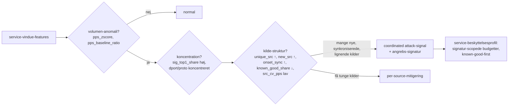

<!-- Sprog: **Dansk** · [English](../EN/ml.md) -->

# J. Machine-learning-arkitektur

ML er en **control-plane-rådgiver**. Den forbruger aggregerede feature-vinduer,
producerer kalibrerede scores og overrækker dem til risiko-motoren, som måske
eller måske ikke handler på dem inden for hårde grænser. Den kører aldrig i XDP,
blokerer aldrig pakke-stien, og dens fravær degraderer detektions-kvalitet, ikke
forwarding (se [architecture.md](architecture.md#failure-modes-and-safe-defaults)).

## Model-portefølje

Bygget i rækkefølgen nedenfor; hver senere model skal slå de tidligere på
evaluerings-protokollen før den får lov at påvirke beslutninger.

| # | Model | Scope | Type | Labels krævet | Output |
|---|---|---|---|---|---|
| 1 | **Statistisk baseline** | global, service | robuste z-scores mod hour-of-week-baselines + CUSUM-ændringsdetektion, pr. feature | ingen | `anomaly_score` (baseline), per-feature-attributioner |
| 2 | **Isolation Forest** | service | usuperviseret anomali-detektor på service-feature-vektoren | ingen (trænet på vinduer baselinen og operatører anser normale) | `anomaly_score` |
| 3 | **DDoS-klassifikator** | service | LightGBM multi-class: `normal`, `syn_flood`, `udp_flood`, `udp_reflection`, `icmp_flood`, `frag_flood`, `ack_rst_flood`, `other_volumetric` | ja | `ddos_score` = 1 − P(normal), angrebstype |
| 4 | **Bot/abuse-klassifikator** | source | LightGBM binær på per-source-adfærd | ja (svag supervision) | `bot_score` |
| 5 | (betinget) sekvens-model | source | lille 1D-CNN/GRU over samplede inter-arrival/størrelse-sekvenser | ja | `bot_score` v2 |

Hver model udsender, pr. scoret entitet:

```json
{
  "entity": {"scope": "service", "id": 17},
  "window_start": "2026-09-28T07:21:43Z",
  "normal_score": 0.03,
  "anomaly_score": 0.94,
  "ddos_score": 0.97,
  "ddos_type": "syn_flood",
  "bot_score": null,
  "confidence": 0.91,
  "model_versions": {"baseline": "v004", "iforest": "v002", "ddos": "v007"},
  "feature_schema_hash": "9f2c…",
  "top_features": [["tcp_syn_ack_ratio", 0.41], ["new_src", 0.22], ["pps_zscore", 0.18]]
}
```

### Scores og konfidens

* Alle scores er **kalibrerede sandsynligheder**: isotonisk regression fittet på
  validerings-splittet (Platt-scaling hvis validerings-positiver < 1 000).
  Isolation Forest-råscores mappes til [0, 1] af den empiriske CDF af scores på
  normale validerings-vinduer (score 0,99 = mere anomal end 99% af normale
  vinduer).
* `normal_score = 1 − max(anomaly_score, ddos_score)` for services,
  `1 − bot_score` for kilder.
* `confidence` er *ikke* scoren. Den er produktet af:
  * **model-sikkerhed**: `2·|p − 0.5|` af den kalibrerede sandsynlighed;
  * **data-kvalitet**: vindue-fuldstændighed (collector-tick-jitter),
    sample-coverage for S-proveniens-features, ring-buffer-tab i vinduet;
  * **distributions-fit**: 1 − fraktion af features uden for træningsområdet
    (per-feature min/max gemt med modellen) — out-of-distribution-input sænker
    konfidens i stedet for at producere et sikkert gæt.
* `top_features`: TreeSHAP-bidrag (LightGBM `pred_contrib`), beregnet i
  trænings-stakken til evaluering og, i produktion, kun for entiteter der udløser
  en handling (det er ~10× omkostningen af en prædiktion).

### Hvorfor disse modeller

* Træer (LightGBM) håndterer mixed-scale, heavy-tailed, missing-value-features
  uden normalisering, er hurtige (µs pr. række), forklarlige via TreeSHAP og
  eksporterer rent til ONNX.
* Isolation Forest giver anomali-detektion uden labels, hvilket er den realistiske
  situation på dag ét.
* Den statistiske baseline er hvad operatøren kan ræsonnere om ("SYN-raten er 14
  MAD'er over sin tirsdag-10:00-median"); den producerer også de normale/abnorme
  pre-labels brugt til at bootstrappe de andre.

### Hvornår deep learning er tilladt

En neural model (PyTorch, eksporteret til ONNX) erstatter eller slutter sig til en
træ-model kun hvis den, på time-split-test-sættet af samme data:
1. forbedrer PR-AUC med ≥ 0,03 absolut, **og**
2. forbedrer recall ved driftspunktets faste FPR (standard 10⁻⁴ pr. vindue) med
   ≥ 5% relativt, **og**
3. p99-inferens-latency for en 10 k-række-batch holder sig < 20 ms på én core.
Den sandsynlige kandidat er bot-modellen på rå inter-arrival-sekvenser; volumetrisk
DDoS-klassifikation er godt dækket af træer på aggregater.

## Bot-detektion (§13)

"Bot" defineres af **adfærd**, ikke volumen. En høj-volumen legitim klient (en
CDN-edge, et backup-job) skal score lavt; en langsom, maskine-paced
credential-stuffing-kilde skal score højt. Signaler, alle pr. kilde:

| Signal | Features |
|---|---|
| maskine-regelmæssig timing | `src_iat_cv` (meget lav), `periodicity_strength` af kildens sub-vindue-tællinger |
| gentagne forbindelsesmønstre | `src_syn_share`, SYN-rate stabil på tværs af vinduer, `src_active_windows` lang med konstant rate |
| gentagen destinationsadfærd | `src_distinct_dports`/`src_distinct_dsts` stabile, `src_share_of_service` |
| gentagne pakkestørrelser | `src_pkt_size_mode_share` høj |
| synkroniserede kilder | kohort-features: mange kilder med næsten-identiske feature-vektorer i de samme vinduer (`src_prefix_cohort`, service `sig_top1_sources`, `src_cv_pps`) |
| usædvanlige protokol-kombinationer | `src_bad_share`, non-standard flag-blandinger, TTL-anomalier (`src_ttl_distinct`) |
| abnorm session-varighed | `flow_duration_*` af kildens samplede flows vs service-baseline |
| gentagne fejl | kun L7: `status_4xx_share`, auth-fejl (når proxy-logs eksisterer) |

Labels (svag supervision, kombineret med Snorkel-lignende label-model-voting
implementeret internt, ~150 linjer): operatør-feedback (`/api/v1/feedback`),
L7-signaler hvor tilgængelige (challenge-fejl, auth-fejl-bursts),
honeypot-/darknet-adresser (al trafik til ubrugte adresser er ikke-legitim),
threat-intel-lister (som en *feature* og en svag label, aldrig som ground truth),
og verificerede-gode sæt (kendte partnere, monitorerings-systemer) som negativer.

## Distribueret angrebs-detektion (§14)

Per-IP-reputation fejler mod store botnets og spoofede floods (hver kilde er
individuelt ubemærkelsesværdig). Detektion er derfor **destinations- og
service-centrisk**:



Coordinated-attack-signalet udløses når, for én service, inden for de samme 3–5
vinduer:
1. volumen er anomal (baseline-model), og
2. trafik koncentreres på én adfærds-signatur (`sig_top1_share ≥ 0.6`), og
3. den signatur bæres af mange kilder (`sig_top1_sources ≥ 50`) der mest er nye
   (`new_src`, `onset_sync ≥ 0.5`) og ikke known-good (`known_good_share` faldet
   med ≥ 50% vs baseline).

Den resulterende mitigering er ikke "blokér N tusind IP'er" men en
**service-beskyttelsesprofil** (policy-engine.md): budgetter scopet til signaturen
(f.eks. UDP fra kildeport 123 til denne service), known-good-kilder undtaget
først, per-source-grænser for ukendte kilder — collateral damage afgrænset ved
konstruktion.

## Træningspipeline (§23)

`ml/` er en Python-pakke (`xs_ml`) med én CLI:
`python -m xs_ml.pipeline --config ml/configs/ddos.yaml`. Hvert trin er en ren
funktion af dets inputs plus et seed, skriver artefakter til en run-mappe og
registrerer hashes, så en kørsel er reproducerbar fra sit manifest.

| Trin | Hvad det gør | Fejler kørslen hvis |
|---|---|---|
| 1. ingest | forespørg ClickHouse `service_windows` / `source_windows` for `[t0, t3)` med `clickhouse-connect` → Arrow → polars; join labels (`attack_events`, `feedback`) | rækkeantal under minimum pr. split |
| 2. clean | drop vinduer med `window_complete = 0`, ring-buffer-tab > 5%, eller collector-genstarter; clip fysisk umulige værdier | > 5% af rækker droppet |
| 3. validate | tjek hver kolonne mod `feature_schema/vN.yaml`: tilstedeværelse, dtype, tilladt område, NaN-politik; sammenlign schema-hashen med dataens registrerede hash | enhver schema-mismatch |
| 4. split by time | train `[t0,t1)`, validation `[t1,t2)`, test `[t2,t3)`, med et **embargo-gap** ≥ det længste feature-lookback (10 min standard, dækker baseline/HLL-union/periodicitets-vinduer) mellem splits; angrebs-*episoder* splittes aldrig på tværs af sæt | en episode spænder en grænse (den flyttes helt ind i det senere split) |
| 5. train | LightGBM med early stopping på validation; class weights fra train-prævalens; Isolation Forest på train-vinduer labeled normal; hyperparametre fra konfiguren (valgfri Optuna-søgning kun på validation) | |
| 6. evaluate | på **test**-splittet: precision, recall, F1, FPR, FNR, confusion matrix, PR-AUC, ROC-AUC, per-angrebstype-recall, time-to-detect (vinduer fra episode-start til første positiv), falske positiver pr. dag ved den valgte tærskel | under gates i konfiguren (f.eks. FPR > 10⁻⁴/vindue) |
| 7. calibrate + threshold | isotonisk kalibrering på validation; vælg driftstærsklen der opfylder target-FPR på validation; rapportér test-metrics ved den tærskel | |
| 8. export | ONNX via onnxmltools (LightGBM) / skl2onnx (Isolation Forest); **paritetstest**: ONNX Runtime vs native prædiktioner på 10 k test-rækker, max abs diff < 1e-5 | paritets-fejl |
| 9. register | skriv artefakt-mappen (nedenfor), opdatér registry-indekset | |

Random splits bruges aldrig: tilstødende 1 s-vinduer er næsten-duplikater, så et
random split lækker test-sættet ind i træning og oppuster hver metrik. Yderligere
lækage-værn: features bruger aldrig information efter `window_end`; baselines brugt
som features beregnes kun fra data før split-grænsen; den samme kildeadresse
tillades i flere splits (virkelighed) men rapporteres separat ("seen-in-train" vs
"unseen" test-kilder).

Datasæt: lab-genererede angreb (TRex/pktgen-profiler afspillet mod en test-service
med registreret ground truth — den primære labelede kilde), produktionsvinduer
labeled via bekræftede hændelser og feedback, og offentlige datasæt (CIC-DDoS2019,
CIC-IDS2017) **kun til pre-training og sanity-checks**: de indeholder kendte
capture-artefakter og afspejler ikke vores feature-pipelines sampling.

## Model-deployment (§24)

### Registry-layout

```
models/                              (på appliancen: /var/lib/xdp-sentinel/models)
├── registry.json                    index: per model → versions, active, previous, mode
├── ddos/
│   ├── v001/
│   └── v002/
│       ├── model.onnx
│       ├── model.lgb.txt            native model (debugging, SHAP)
│       ├── feature_schema.yaml      exact copy of the training schema
│       ├── manifest.json            version, created_at, git_sha, data ranges,
│       │                            row counts, seed, library versions,
│       │                            schema_hash, feature ranges, sha256 of files
│       ├── calibration.json
│       ├── thresholds.json          operating points (FPR targets → thresholds)
│       └── metrics.json             test metrics, confusion matrix
├── bot/
│   └── v001/
├── iforest/
└── baseline/                        baseline parameters are versioned the same way
```

### Aktivering og rollback

1. Træning skriver en ny version; intet ændres på appliancen.
2. `sentinelctl model install ddos v002` (eller API'et) kopierer den ind,
   verificerer fil-hashes mod `manifest.json`, verificerer
   `schema_hash == agentens feature-extractor-hash`, og loader den ind i
   `sentinel-inference` **i shadow-mode**: scoret sideløbende med den aktive model,
   beslutninger logget til `policy_decisions` med `mode = 'shadow'`, aldrig
   håndhævet.
3. Efter en shadow-periode (standard 7 dage) viser dashboardet active-vs-candidate-
   enighed og hvad kandidaten *ville* have gjort; `activate ddos v002 --mode enforce`
   promoverer den. `registry.json` beholder `previous = v001`.
4. **Rollback** = `activate ddos v001` (eller `rollback ddos`): et atomisk
   pointer-swap; inferens-processen beholder den forrige model loadet til øjeblikkelig
   tilbageskiftning.
5. Policy-motoren registrerer `model_version`, `feature_schema_version` (hash) og
   beslutnings-timestampet i hver `policy_decisions`-række, så enhver mitigering kan
   spores til den eksakte model der forårsagede den.

Værn: en model hvis schema-hash ikke matcher afvises (deterministisk detektion
fortsætter); en model der crasher eller overskrider sit latency-budget (p99 > 50 ms
pr. batch) tre gange nedgraderes automatisk til shadow og en alarm udløses.

### Inferens-tjeneste

`sentinel-inference` (Rust, ONNX Runtime): én session pr. model, intra-op-tråde = 1,
inter-op = 1 (forudsigelig latency, ingen oversubscription af control-plane-cores),
batches på op til 10 k rækker, input-tensor genbrugt på tværs af kald. Forventet
omkostning for træ-ensembler på ~500 træer: titals af µs pr. 1 k rækker (*estimat*;
målt i Fase 10-benchmarks, `benchmarks/inference/`).

## Model-forgiftning og undvigelse

Se [threat-model.md](threat-model.md). Kort sagt: træningsdata udelukker vinduer
under aktiv mitigering af modellen der trænes (feedback-loop), labels fra feedback
kræver operatørrolle og auditeres, modeller kører i shadow før håndhævelse,
ML-initierede handlinger er loftsatte
([policy-engine.md](policy-engine.md#guard-rails-against-the-model)), og
deterministisk beskyttelse afhænger ikke af nogen model.
