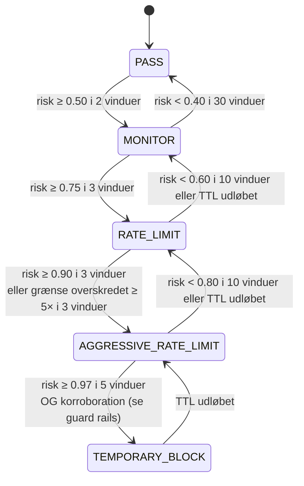

<!-- Sprog: **Dansk** · [English](../EN/policy-engine.md) -->

# K. Risiko- / policy-motor

Dækker kravsektionerne 7 (rate limiting), 8 (hurtig mitigering), 15
(risiko-motor), 16 (falsk-positiv-kontrol) og 17 (allowlists).

Policy-motoren er den eneste komponent der har lov at ændre hvad dataplanet gør.
Den omsætter evidens til **afgrænsede, udløbende** handlinger:

```
evidence (rules, baselines, models, reputation, history)
   → per-entity risk + explanation
   → action ladder with hysteresis, confidence floors, budgets
   → policy diff (with TTL) → BPF maps
```

## Entiteter

| Entitet | Nøgle | Typiske handlinger |
|---|---|---|
| source | IPv4 /32, IPv6 /64 | MONITOR, SAMPLE, RATE_LIMIT, AGGRESSIVE_RATE_LIMIT, TEMPORARY_BLOCK |
| prefix | IPv4 /24, IPv6 /48 (aggregeret når mange kilder i ét præfiks opfører sig forkert) | samme, via LPM-mappet |
| service | destinations-præfiks | beskyttelsesprofil: NORMAL / SUSPECT / UNDER_ATTACK |

## Evidens

| Signal | Kilde | Altid tændt? |
|---|---|---|
| deterministiske regler | tærskler i konfig (absolutte lofter pr. service/source, malformed-andel, bad-flag-rates, SYN/ACK-ratio) | **ja**, uafhængigt af ML |
| statistisk baseline | robuste z-scores + CUSUM ([ml.md](ml.md)) | ja (ingen modelfil krævet) |
| anomali-model | Isolation Forest | hvis loadet |
| DDoS-model | LightGBM, med angrebstype | hvis loadet |
| bot-model | LightGBM pr. kilde | hvis loadet |
| reputation | intern offence-historik (henfaldende), operatør-lister, valgfrie threat-intel-feeds | ja |
| historik | known-good-sæt pr. service (kilder med normal adfærd i de 24 t før en anomali) | ja |

## Risiko-score

For hver entitet og vindue yder hvert signal *i* en kalibreret sandsynlighed
`p_i` for "skadelig", en konfidens `c_i` og en vægt `w_i` (konfig, pr.
service-klasse). Signaler under konfidens-gulvet (`c_i < 0.6`) bidrager ikke til
eskalering. Risikoen er en noisy-OR:

```
risk = 1 − Π_i (1 − w_i · p_i)        over signals with c_i ≥ c_min
```

Noisy-OR bruges fordi den er monoton (mere evidens sænker aldrig risiko),
afgrænset i [0, 1], forklarlig (hver faktors bidrag gemmes), og ikke kræver at
signalerne er fælles-kalibrerede. Hver beslutning gemmer den fulde
bidrags-vektor i `policy_decisions`.

Deterministiske regler omgår scoren: en regel sætter en **minimums**-handling
(f.eks. "kilde overskrider 50 k pps til en service hvis absolutte per-source-loft
er 20 k pps → mindst RATE_LIMIT ved 20 k pps"). ML kan hæve handlingen inden for
sine lofter; den kan aldrig sænke en regels minimum.

## Handlings-stige og hysterese



* **Separate op/ned-tærskler** (f.eks. træd ind i RATE_LIMIT ved 0,75, forlad
  under 0,60) og **krav om fortløbende vinduer** (`k_up`, `k_down`) forhindrer
  flapping.
* **Ét niveau ad gangen**, undtagen deterministiske regler, der kan springe
  direkte til deres minimums-handling.
* **De-eskalering træder ned**, den nulstiller ikke til PASS: en blokeret kilde
  kommer tilbage rate-limited, så monitored.
* **Cooldown:** efter en de-eskalering kan entiteten ikke genindtræde samme
  niveau i `cooldown` (standard 30 s) med mindre risiko overskrider
  indgangstærsklen med en margin (+0,05).
* Alle tærskler er pr. service-klasse (`[policy.service_class.<name>]`), fordi en
  DNS-resolver, en spilserver og en web-frontend har forskellig normal adfærd.

## TTL'er

Hver handling bærer en TTL; intet er permanent.

```
ttl = min(base_ttl(level) × 2^offences_24h, max_ttl(level))
```

| Niveau | base_ttl | max_ttl (automatisk) |
|---|---|---|
| MONITOR / SAMPLE | 60 s | 10 min |
| RATE_LIMIT | 60 s | 30 min |
| AGGRESSIVE_RATE_LIMIT | 60 s | 30 min |
| TEMPORARY_BLOCK | 60 s | 1 h |
| manuel (API, operatør) | påkrævet felt | 7 d |

`offences_24h` henfalder: en offence ældre end 24 t tæller ikke længere. Mens
evidens vedvarer *forlænger* motoren TTL'en (omskriver `expires_ns`); når evidens
stopper udløber entryen af sig selv, selv hvis agenten er død, fordi XDP selv
tjekker `expires_ns`.

## Guard rails mod modellen

ML-output er ubetroet input. Håndhæves uanset scores:

1. **Handlings-loft:** `ml_max_action` (standard `RATE_LIMIT`) er den højeste
   handling der kan nås på ML-evidens alene. `TEMPORARY_BLOCK` kræver derudover
   deterministisk korroboration (en regel der fyrer for entiteten) eller enighed
   mellem to uafhængige detektorer (baseline + DDoS-model) med konfidens ≥ 0,9 i
   ≥ 5 vinduer.
2. **Shadow først:** nye modeller starter i `shadow`-mode; deres beslutninger
   registreres med `mode = 'shadow'` og anvendes aldrig.
3. **Collateral circuit breaker (pr. service):** hvis mere end
   `max_known_good_drop_share` (standard 1%) af known-good-kildernes pakker til en
   service droppes eller begrænses af ML-originede politikker, fryses
   ML-eskaleringer for den service, de krænkende politikker nedgraderes til
   MONITOR, og `PolicyCircuitBreakerOpen` fyrer.
4. **Ændringsrate:** højst `max_new_ml_policies_per_min` (standard 10 000) nye
   ML-originede politikker pr. minut og højst `max_active_ml_blocks` (standard
   100 000) aktive ML-blokke; derudover foretrækker motoren service-niveau-beskyttelse
   over per-source-entries.
5. **Map-budget:** motoren fylder aldrig et policy-map over 90%; lav-prioritets-entries
   (MONITOR/SAMPLE) er de første der afvises.
6. **Allowlist-præcedens:** motoren nægter at oprette en politik der overlapper en
   allowlist-entry, og XDP tjekker allowlisten først alligevel.
7. **Model-sundhed:** schema-hash-mismatch, OOD-input, latency-overtrædelser eller
   crashes nedgraderer modellen til shadow (se [ml.md](ml.md)).

## Rate limiting

Krav 7: pakker/s, bytes/s, SYN/s, UDP-pakker/s, og forbindelser/s hvor
observerbart (= SYN/s pr. kilde; fuldførte forbindelser er ikke observerbare på
L3/L4 uden connection tracking).

To mekanismer, valgt efter *hvem der deler bucket'en*:

| | Per-source-grænser | Service- (aggregerede) budgetter |
|---|---|---|
| Trafik | én kilde, muligvis spredt på alle RX-køer af RSS | mange kilder, spredt jævnt på køer |
| Algoritme | **GCRA** på ét delt 64-bit-ord, compare-and-swap | **token bucket pr. CPU**, limit / n_rx_queues |
| Nøjagtighed | eksakt | eksakt i forventning (store tals lov på tværs af RSS) |
| Contention | kun for rate-limited kilder (få ved konstruktion) | ingen |
| Map | `xs_src_policy_*`-value (`struct xs_gcra`) | `xs_service_state` (PERCPU_ARRAY) |

### GCRA (Generic Cell Rate Algorithm)

GCRA er virtual-scheduling-formen af leaky bucket, ækvivalent i optaget trafik med
en token bucket med rate `r` og burst `b`, men hele dens state er ét timestamp,
den *theoretical arrival time* (TAT):

```
T = 1e9 / r                 (ns per packet)
τ = T × (b − 1)             (burst tolerance)

on packet at time now:
    tat  = load(state.tat_ns)
    base = max(tat, now)
    if base − now > τ:          → nonconforming (drop); state unchanged
    new  = base + T
    if !CAS(&state.tat_ns, tat, new):
        retry once with a fresh tat
        if the retry fails too: → nonconforming
```

Hvorfor GCRA frem for alternativerne:

| Algoritme | State | Update fra mange CPU'er | Problem |
|---|---|---|---|
| **GCRA** | 1 × u64 | enkelt CAS (`__sync_val_compare_and_swap`, BPF-atomics, ≥ 5.12) | ingen relevante |
| token bucket | tokens + last refill (2 ord) | kræver en lås (`bpf_spin_lock`) eller en 128-bit CAS (ikke tilgængelig) | lås pr. pakke fra hver CPU |
| leaky bucket som en kø | kø | — | XDP kan ikke forsinke pakker |
| fixed window counter | counter + window id | atomic add | op til 2× burst ved vindue-grænser |
| sliding window log/counters | flere tællere | atomics | mere hukommelse og aritmetik for samme resultat |

Under contention (én rate-limited kilde der hamrer mange CPU'er) er det at fejle
det andet CAS-forsøg som nonconforming det konservative valg: contentionen selv
beviser at kilden sender langt over sin grænse.

**Bytes/s:** samme algoritme med increment `len × T_byte`, hvor `T_byte` gemmes som
fixed-point 1/1024 ns så høje byte-rates (f.eks. 10 Gb/s → 0,8 ns/byte) ikke
rundes til nul. Både pakke- og byte-limiteren skal konformere. En pakke der passerer
pakke-limiteren men fejler byte-limiteren har allerede forbrugt en pakke-slot; dette
under-optager en smule, hvilket er acceptabelt for en limiter.

**Klasser:** `xs_policy` holder fire pakke-limitere, én pr. trafik-klasse (`ANY`,
`TCP_SYN`, `UDP`, `ICMP`), plus en byte-limiter for `ANY`, så "500 SYN/s og 5 000
UDP pps for denne kilde" er én entry og ét opslag.

### Per-CPU token bucket (service-budgetter)

```
state (per CPU): tokens_x1024, last_ns
rate_cpu  = budget_pps / n_rx_queues
refill    = (now − last_ns) × rate_cpu × 1024 / 1e9
tokens    = min(tokens + refill, burst_cpu × 1024)
if tokens ≥ 1024: tokens −= 1024 → conforming
else: nonconforming
```

Ingen atomics: staten er per-CPU og kun dens egen CPU rører den. `n_rx_queues`
skrives ind i `xs_service_cfg` af agenten når den konfigurerer NIC'en.

### Udløb

Rate-limit-politikker er almindelige `xs_policy`-entries og udløber som enhver
anden (`expires_ns`). GCRA-state nulstilles naturligt: efter idle-tid, `base = now`.

## Service-beskyttelse (distribuerede angreb)

Når coordinated-attack-signalet fyrer for en service
([ml.md](ml.md#distributed-attack-detection-14)), skalerer per-source-blokering ikke
(titusinder af kilder, muligvis spoofede). Servicen flytter
`NORMAL → SUSPECT → UNDER_ATTACK` (med hysterese) og motoren installerer en
**beskyttelsesprofil**:

1. **Signatur-scopede budgetter:** per-CPU-budgetter på angrebets trafik-klasse for
   den destination (f.eks. UDP med kildeport 123 → service X begrænset til 3 × sin
   baseline-p99), hvilket lader andre klasser være urørte.
2. **Known-good først:** kilder i servicens known-good-sæt omgår service-budgettet. I
   XDP er dette et `BPF_MAP_TYPE_BLOOM_FILTER` (≥ 5.16) populeret af agenten
   før/ved angrebs-onset: ét `bpf_map_peek_elem`, ~1% falsk-positiv-rate ved 10 bits
   pr. entry.
3. **Ukendte kilder** deler det resterende budget og får per-source GCRA-grænser
   hvis individuelt tunge.
4. **Valgfri aggressiv mode** (eksplicit per-service-konfig): drop
   angrebs-signatur-klassen helt for kilder der ikke er known-good, eller aktivér
   `drop_fragments` for den service.

Collateral er afgrænset ved konstruktion: legitime klienter med historik beholder
fuld service; nye legitime klienter konkurrerer med angrebstrafik om budgettet i
stedet for at blive blokeret direkte.

## Falsk-positiv-kontrol (§16)

| Mekanisme | Hvor |
|---|---|
| konfidens-tærskler | konfidens-gulv pr. signal; konfidens inkluderer data-kvalitet og OOD-tjek |
| hysterese | separate indgangs-/udgangs-tærskler, `k_up`/`k_down` fortløbende vinduer |
| cooldown-perioder | pr. entitet og niveau |
| midlertidige politikker | hver automatisk handling har en TTL; eksponentiel kun for gentagne krænkere; max 1 h |
| allowlists / betroede netværk | tjekket først i XDP; policy-oprettelse nægter overlap |
| service-specifikke tærskler | `service_class`-konfiguration |
| destinations-specifikke baselines | baselines pr. service og hour-of-week |
| automatisk udløb | håndhævet i XDP via `expires_ns`, uafhængigt af agenten |
| feedback | `POST /api/v1/feedback`: en operatør-markeret falsk positiv fjerner straks politikken, tilføjer entiteten til en 24 t-undtagelse for de involverede signaler, og bliver en træningslabel |
| shadow-mode og circuit breaker | [guard rails](#guard-rails-against-the-model) |

Ingen enkelt anomal observation kan blokere noget: den hurtigste automatiske sti
til `TEMPORARY_BLOCK` kræver vedvarende evidens over ≥ 13 vinduer (2 + 3 + 3 + 5) og
korroboration, undtagen deterministiske regler konfigureret af operatøren.

## Allowlists (§17)

| Type | Eksempel | Match |
|---|---|---|
| source IPv4/IPv6-adresser og CIDR'er | monitorerings-systemer, partnere | LPM på source |
| management-netværk | `10.0.0.0/8` via management-NIC'en | LPM på source, `trust = full` |
| destinationsadresser/CIDR'er | en DNS-resolver der aldrig må røres | LPM på destination (tjekket i service-trinnet) |
| betroede services | `(dst prefix, proto, port)` mitigeres aldrig | service-config-flag |

Evaluering sker i XDP før ethvert mitigerings-trin
([architecture.md F.2](architecture.md#f2-per-packet-pipeline-final-form-phases-15)).
Control-plane-validering: CIDR-syntaks, ingen entries bredere end /8 (IPv4) eller
/32 (IPv6) uden et eksplicit `force`, en obligatorisk kommentar, valgfrit udløb,
audit-log. Fordi kildeadresser kan spoofes, defaulter internet-vendte
allowlist-entries til `trust = dynamic_exempt` (undtaget fra dynamiske politikker,
stadig underlagt statiske lofter); `full` tillid er til stier hvor spoofing er
umulig (management-NIC, uRPF-beskyttede interne links).

## Konfigurations-skitse

```toml
[policy]
mode = "enforce"                   # "shadow" = compute and log, never write maps
ml_max_action = "rate_limit"
confidence_floor = 0.6
max_new_ml_policies_per_min = 10000
max_active_ml_blocks = 100000
max_known_good_drop_share = 0.01

[policy.ttl]
base_s = 60
max_auto_s = 3600
max_manual_s = 604800

[policy.service_class.web]
thresholds = { monitor = [0.50, 0.40], rate_limit = [0.75, 0.60], aggressive = [0.90, 0.80], block = [0.97, 0.90] }
windows    = { up = [2, 3, 3, 5], down = [30, 10, 10, 1] }
per_source_cap = { pps = 20000, syn_pps = 500 }
weights    = { rules = 1.0, baseline = 0.6, iforest = 0.4, ddos = 0.8, bot = 0.5, reputation = 0.3 }

[[service]]
name = "www"
prefix = "203.0.113.10/32"
class = "web"
protection = "balanced"            # "off" | "balanced" | "aggressive"
```
