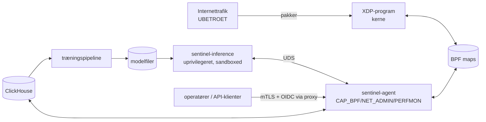

<!-- Sprog: **Dansk** · [English](../EN/threat-model.md) -->

# O. Trusselsmodel for selve appliancen

Appliancen sidder i stien for fjendtlig trafik og har magten til at droppe
legitim trafik, hvilket gør den til både et mål og et våben.

## Aktiver

1. **Tilgængelighed af beskyttede tjenester**, herunder mod at appliancen selv
   fejlagtigt dropper legitim trafik.
2. **Integritet af dataplanet**: XDP-programmet og dets maps (politikker,
   allowlists, konfiguration).
3. **Integritet af beslutninger**: modeller, feature-pipeline, træningsdata,
   labels.
4. **Tilgængelighed af appliancens management- og telemetristi.**
5. Fortrolighed af telemetri (adresser og trafik-metadata er personoplysninger i
   mange jurisdiktioner).

## Tillidsgrænser

Alt til venstre for XDP er fjendtligt. Modelfiler, træningsdata og labels er
*semi-betroede*: produceret af os, men påvirket af trafik som en angriber
kontrollerer.

## Trusler og modforanstaltninger

| # | Trussel | Modforanstaltning | Restrisiko |
|---|---|---|---|
| 1 | **Ondsindede / malformede pakker** crasher eller forvirrer parseren | Verifier-bevist hukommelsessikkerhed; hvert længdefelt afgrænset og valideret; 24-vejs klassifikation af parse-udfald; host-fuzzing (trunkeringer + bit-flips under ASan/UBSan) og in-kernel corpus-tests (Fase 1) | Logiske fejl i klassifikationen (tests dækker corpus'et, ikke alle inputs) |
| 2 | **Parser-undvigelse**: angrebstrafik skjult bag VLAN-stakke, IPv6-extension-kæder, fragmenter | Ikke-understøttede dybder tælles (`parse_unsup_*`) og er synlige; `drop_fragments` pr. tjeneste under angreb; små første-fragmenter flagges (RFC 1858); extension-kædegrænse (6) over virkelighedens brug | Trafik ud over parse-dybden sendes videre (ved design, RFC 7045); den er synlig i tællere og kan rate-limitte­s som klasse |
| 3 | **Map-udtømning**: angriber fylder per-source- eller flow-tabeller | Angriber-nøglede tabeller er LRU med probabilistisk optagelse (≤ pps/1024 indsættelser); politiktabeller er control-plane-only HASH med budgetter; ingen per-flow-tabel i XDP | Heavy-hitter-tabellen udskiftes hurtigt under enorme botnets (nøjagtighedstab, ingen nedbrud) |
| 4 | **Flow-tabel-udtømning i userspace** | Flow-rekonstruktion fodres af loftsatte samples; hård kapacitet + LRU; afgrænsede køer | Reduceret flow-synlighed ved ekstreme kilde-antal |
| 5 | **CPU-udtømning** (per-pakke-omkostning, cache-miss-floods) | Fast per-pakke-arbejde (ingen datadrevne løkker ud over faste grænser); ≥ 2,5× core-headroom; RSS på porte; NIC-drop-tællere alarmerer; Fase 16-benchmarks med random-source-floods | Link- eller NIC-mætning ud over 10 G kan kun løses opstrøms |
| 6 | **Telemetri-flooding** (gør sampleren/ring-bufferen til flaskehalsen) | Per-CPU sample-token-bucket; `BPF_RB_NO_WAKEUP`; tab tælles, blokerer aldrig; features degraderer til tæller-/sketch-baserede med lavere konfidens | Sample-afledte features mindre nøjagtige under ekstreme floods |
| 7 | **Userspace-kompromittering** af agenten | Mindste privilegium: dedikeret bruger, ambient caps kun `CAP_BPF`, `CAP_PERFMON`, `CAP_NET_ADMIN`; systemd-hærdning (`ProtectSystem=strict`, `NoNewPrivileges`, `SystemCallFilter`, `RestrictAddressFamilies`); Rust; ingen model-parsing i denne proces; API kun på management-netværket | En agent-kompromittering styrer dataplanet (iboende: den ér control plane) |
| 8 | **Kompromittering via modelfiler** (parser-exploits i ONNX Runtime) | Inferens i en separat uprivilegeret, sandboxet proces (DynamicUser, intet netværk, read-only modelmappe, seccomp); modelfiler hash-verificeret mod det signerede manifest | En ondsindet model kan stadig udsende dårlige scores → afgrænset af guard rails (#10) |
| 9 | **Politik-injektion** via API | mTLS/OIDC ved proxyen; operatørrolle til mutationer; streng validering (typer, CIDR-syntaks, TTL-grænser, allowlist-overlap, entry-budgetter); audit-log; `deny_unknown_fields` i konfig-parsing; idempotensnøgler | En stjålet operatør-credential kan oprette politikker (afgrænset af TTL ≤ 7 d og audit) |
| 10 | **Model-forgiftning**: angriber former trafik, så fremtidig træning lærer angreb som normalt, eller får normalt til at ligne ondsindet | Træning udelukker vinduer under aktiv mitigering og ulabelede angrebs-episoder; labels fra feedback kræver operatørrolle og auditeres; time-split-evaluering med faste test-gates; shadow-periode før håndhævelse; ML-handlingsloft (`RATE_LIMIT` som standard); collateral circuit breaker; deterministisk beskyttelse uafhængig af ML | Langsomme drift-angreb over måneder kunne flytte baselines; afbødet af baseline-vinduer (4 uger) og gennemgang af baseline-vækst |
| 11 | **Adversariel undvigelse** (trafik lavet så den ligner normal for modellen) | Modeller er ét input blandt flere; deterministiske lofter (absolutte per-source- og per-service-budgetter) afhænger ikke af modellens vurdering; service-beskyttelsesprofiler begrænser den samlede effekt uanset klassifikation | En perfekt efterlignet flood under per-source-lofter fra mange kilder er kun afgrænset af service-budgetter |
| 12 | **Spoofede kildeadresser** | Service-niveau (destinations-centrisk) mitigering afhænger ikke af kildeidentitet; per-source-blokke har korte TTL'er (spoofede ofre kommer sig); allowlistede internet-vendte kilder er `dynamic_exempt`, ikke `full` tillid; TTL- og præfiks-diversitets-features opdager spoofing | Reflektionsofre for vores egne blokke (en angriber der spoofer en partners adresse) → allowlist partnere, korte TTL'er |
| 13 | **Selv-DoS via falske positiver** | Hysterese, konfidens-gulve, TTL'er, known-good-first, circuit breaker, shadow-mode, sikre standardvalg (observe-only dataplan-konfig) | Fejlkonfigurerede deterministiske regler (operatørfejl) → konfig-validering + dry-run-mode |
| 14 | **Tidsmanipulation** (NTP) for at udløbe eller forlænge politikker | Dataplan og agent bruger CLOCK_MONOTONIC til alle TTL'er | ingen kendt |
| 15 | **Management-plane uopnåelig under angreb** | Separat management-NIC; management-netværk allowlistet med `full` tillid kun på den NIC | Out-of-band-adgang stadig anbefalet (BMC) |
| 16 | **Loader-/opgraderingsfejl efterlader interface ubeskyttet** | Atomisk `XDP_FLAGS_REPLACE` kun efter succesfuld load; `UPDATE_IF_NOEXIST` forhindrer overskrivning; pinnede maps genbruges | — |
| 17 | **Supply chain** (crates, Python-pakker, base-images) | `Cargo.lock` committet, `cargo deny` / `cargo audit` i CI, pinnede Python-requirements med hashes, reproducerbar dev-container | Standard økosystem-risiko |
| 18 | **Telemetri-fortrolighed** | ClickHouse på management-netværket med TLS; least-privilege DB-brugere; TTL'er på alle tabeller (≤ 400 dage, rå samples 3 dage, slået fra som standard) | Opbevaringspolitik skal matche lokal lovgivning |

## Principper afledt af modellen

* **Stol aldrig på pakkefelter** til andet end klassifikation; længder valideres,
  bruges aldrig uafgrænset.
* **Valider alt control-plane-input** ved API-grænsen og igen ved
  map-writer-grænsen (writeren afviser entries uden TTL eller overlappende
  allowlists, uanset kalderen).
* **Afgræns alt:** hver tabel, kø, rate, TTL og ML-drevet handling har en grænse
  og en metrik.
* **Fejl åbent for tilgængelighed, lukket for privilegium:** en knækket control
  plane stopper med at mitigere (politikker udløber); den begynder aldrig at
  droppe.
