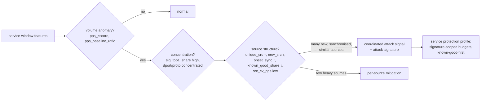

<!-- Language: **English** · [Dansk](../DK/ml.md) -->

# J. Machine-learning architecture

ML is a **control-plane advisor**. It consumes aggregated feature windows,
produces calibrated scores, and hands them to the risk engine, which may or
may not act on them within hard limits. It never runs in XDP, never blocks
the packet path, and its absence degrades detection quality, not
forwarding (see [architecture.md](architecture.md#failure-modes-and-safe-defaults)).

## Model portfolio

Built in the order below; each later model must beat the earlier ones on
the evaluation protocol before it is allowed to influence decisions.

| # | Model | Scope | Type | Labels needed | Output |
|---|---|---|---|---|---|
| 1 | **Statistical baseline** | global, service | robust z-scores against hour-of-week baselines + CUSUM change detection, per feature | none | `anomaly_score` (baseline), per-feature attributions |
| 2 | **Isolation Forest** | service | unsupervised anomaly detector on the service feature vector | none (trained on windows the baseline and operators consider normal) | `anomaly_score` |
| 3 | **DDoS classifier** | service | LightGBM multi-class: `normal`, `syn_flood`, `udp_flood`, `udp_reflection`, `icmp_flood`, `frag_flood`, `ack_rst_flood`, `other_volumetric` | yes | `ddos_score` = 1 − P(normal), attack type |
| 4 | **Bot/abuse classifier** | source | LightGBM binary on per-source behaviour | yes (weak supervision) | `bot_score` |
| 5 | (conditional) sequence model | source | small 1D-CNN/GRU over sampled inter-arrival/size sequences | yes | `bot_score` v2 |

Every model emits, per scored entity:

```json
{
  "entity": {"scope": "service", "id": 17},
  "window_start": "2026-09-28T07:21:43Z",
  "normal_score": 0.03,
  "anomaly_score": 0.94,
  "ddos_score": 0.97,
  "ddos_type": "syn_flood",
  "bot_score": null,
  "confidence": 0.91,
  "model_versions": {"baseline": "v004", "iforest": "v002", "ddos": "v007"},
  "feature_schema_hash": "9f2c…",
  "top_features": [["tcp_syn_ack_ratio", 0.41], ["new_src", 0.22], ["pps_zscore", 0.18]]
}
```

### Scores and confidence

* All scores are **calibrated probabilities**: isotonic regression fitted
  on the validation split (Platt scaling if validation positives < 1 000).
  Isolation Forest raw scores are mapped to [0, 1] by the empirical CDF of
  scores on normal validation windows (score 0.99 = more anomalous than 99%
  of normal windows).
* `normal_score = 1 − max(anomaly_score, ddos_score)` for services,
  `1 − bot_score` for sources.
* `confidence` is *not* the score. It is the product of:
  * **model certainty**: `2·|p − 0.5|` of the calibrated probability;
  * **data quality**: window completeness (collector tick jitter), sample
    coverage for S-provenance features, ring-buffer loss in the window;
  * **distribution fit**: 1 − fraction of features outside the training
    range (per-feature min/max stored with the model) — out-of-distribution
    input lowers confidence instead of producing a confident guess.
* `top_features`: TreeSHAP contributions (LightGBM `pred_contrib`), computed
  in the training stack for evaluation and, in production, only for entities
  that trigger an action (it is ~10× the cost of a prediction).

### Why these models

* Trees (LightGBM) handle mixed-scale, heavy-tailed, missing-value
  features without normalisation, are fast (µs per row), explainable via
  TreeSHAP, and export cleanly to ONNX.
* Isolation Forest gives anomaly detection with no labels, which is the
  realistic situation on day one.
* The statistical baseline is what the operator can reason about ("SYN
  rate is 14 MADs above its Tuesday-10:00 median"); it also produces the
  normal/abnormal pre-labels used to bootstrap the others.

### When deep learning is allowed

A neural model (PyTorch, exported to ONNX) replaces or joins a tree model
only if, on the time-split test set of the same data:
1. PR-AUC improves by ≥ 0.03 absolute, **and**
2. recall at the operating point's fixed FPR (default 10⁻⁴ per window)
   improves by ≥ 5% relative, **and**
3. p99 inference latency for a 10 k-row batch stays < 20 ms on one core.
The likely candidate is the bot model on raw inter-arrival sequences;
volumetric DDoS classification is well served by trees on aggregates.

## Bot detection (§13)

"Bot" is defined by **behaviour**, not volume. A high-volume legitimate
client (a CDN edge, a backup job) must score low; a slow, machine-paced
credential-stuffing source must score high. Signals, all per source:

| Signal | Features |
|---|---|
| machine-regular timing | `src_iat_cv` (very low), `periodicity_strength` of the source's sub-window counts |
| repeated connection patterns | `src_syn_share`, SYN rate stable across windows, `src_active_windows` long with constant rate |
| repeated destination behaviour | `src_distinct_dports`/`src_distinct_dsts` stable, `src_share_of_service` |
| repeated packet sizes | `src_pkt_size_mode_share` high |
| synchronised sources | cohort features: many sources with near-identical feature vectors in the same windows (`src_prefix_cohort`, service `sig_top1_sources`, `src_cv_pps`) |
| unusual protocol combinations | `src_bad_share`, non-standard flag mixes, TTL anomalies (`src_ttl_distinct`) |
| abnormal session duration | `flow_duration_*` of the source's sampled flows vs service baseline |
| repeated failures | L7 only: `status_4xx_share`, auth failures (when proxy logs exist) |

Labels (weak supervision, combined with Snorkel-style label-model
voting implemented in-house, ~150 lines): operator feedback
(`/api/v1/feedback`), L7 signals where available (challenge failures,
auth-failure bursts), honeypot/darknet addresses (any traffic to unused
addresses is non-legitimate), threat-intel lists (as a *feature* and a weak
label, never as ground truth), and verified-good sets (known partners,
monitoring systems) as negatives.

## Distributed attack detection (§14)

Per-IP reputation fails against large botnets and spoofed floods (each
source is individually unremarkable). Detection is therefore
**destination- and service-centric**:



The coordinated-attack signal fires when, for one service, within the same
3–5 windows:
1. volume is anomalous (baseline model), and
2. traffic concentrates on one behaviour signature
   (`sig_top1_share ≥ 0.6`), and
3. that signature is carried by many sources (`sig_top1_sources ≥ 50`)
   that are mostly new (`new_src`, `onset_sync ≥ 0.5`) and not known-good
   (`known_good_share` dropped by ≥ 50% vs baseline).

The resulting mitigation is not "block N thousand IPs" but a **service
protection profile** (policy-engine.md): budgets scoped to the signature
(e.g. UDP from source port 123 to this service), known-good sources
exempted first, per-source limits for unknown sources — collateral damage
bounded by construction.

## Training pipeline (§23)

`ml/` is a Python package (`xs_ml`) with one CLI:
`python -m xs_ml.pipeline --config ml/configs/ddos.yaml`. Every stage is a
pure function of its inputs plus a seed, writes artefacts to a run
directory, and records hashes, so a run is reproducible from its manifest.

| Stage | What it does | Fails the run if |
|---|---|---|
| 1. ingest | query ClickHouse `service_windows` / `source_windows` for `[t0, t3)` with `clickhouse-connect` → Arrow → polars; join labels (`attack_events`, `feedback`) | row count below minimum per split |
| 2. clean | drop windows with `window_complete = 0`, ring-buffer loss > 5%, or collector restarts; clip physically impossible values | > 5% of rows dropped |
| 3. validate | check every column against `feature_schema/vN.yaml`: presence, dtype, allowed range, NaN policy; compare the schema hash with the data's recorded hash | any schema mismatch |
| 4. split by time | train `[t0,t1)`, validation `[t1,t2)`, test `[t2,t3)`, with an **embargo gap** ≥ the longest feature lookback (10 min default, covers baseline/HLL-union/periodicity windows) between splits; attack *episodes* are never split across sets | an episode spans a boundary (it is moved wholly into the later split) |
| 5. train | LightGBM with early stopping on validation; class weights from train prevalence; Isolation Forest on train windows labelled normal; hyperparameters from the config (optional Optuna search on validation only) | |
| 6. evaluate | on the **test** split: precision, recall, F1, FPR, FNR, confusion matrix, PR-AUC, ROC-AUC, per-attack-type recall, time-to-detect (windows from episode start to first positive), false positives per day at the chosen threshold | below the gates in the config (e.g. FPR > 10⁻⁴/window) |
| 7. calibrate + threshold | isotonic calibration on validation; choose the operating threshold that meets the target FPR on validation; report test metrics at that threshold | |
| 8. export | ONNX via onnxmltools (LightGBM) / skl2onnx (Isolation Forest); **parity test**: ONNX Runtime vs native predictions on 10 k test rows, max abs diff < 1e-5 | parity failure |
| 9. register | write the artefact directory (below), update the registry index | |

Random splits are never used: adjacent 1 s windows are near-duplicates, so
a random split leaks the test set into training and inflates every metric.
Additional leakage guards: features never use information after
`window_end`; baselines used as features are computed only from data
before the split boundary; the same source address is allowed in several
splits (reality) but reported separately ("seen-in-train" vs
"unseen" test sources).

Datasets: lab-generated attacks (TRex/pktgen profiles replayed against a
test service with recorded ground truth — the primary labelled source),
production windows labelled via confirmed incidents and feedback, and
public datasets (CIC-DDoS2019, CIC-IDS2017) for **pre-training and sanity
checks only**: they contain known capture artefacts and do not reflect our
feature pipeline's sampling.

## Model deployment (§24)

### Registry layout

```
models/                              (on the appliance: /var/lib/xdp-sentinel/models)
├── registry.json                    index: per model → versions, active, previous, mode
├── ddos/
│   ├── v001/
│   └── v002/
│       ├── model.onnx
│       ├── model.lgb.txt            native model (debugging, SHAP)
│       ├── feature_schema.yaml      exact copy of the training schema
│       ├── manifest.json            version, created_at, git_sha, data ranges,
│       │                            row counts, seed, library versions,
│       │                            schema_hash, feature ranges, sha256 of files
│       ├── calibration.json
│       ├── thresholds.json          operating points (FPR targets → thresholds)
│       └── metrics.json             test metrics, confusion matrix
├── bot/
│   └── v001/
├── iforest/
└── baseline/                        baseline parameters are versioned the same way
```

### Activation and rollback

1. Training writes a new version; nothing changes on the appliance.
2. `sentinelctl model install ddos v002` (or the API) copies it in,
   verifies file hashes against `manifest.json`, verifies
   `schema_hash == agent's feature extractor hash`, and loads it into
   `sentinel-inference` **in shadow mode**: scored alongside the active
   model, decisions logged to `policy_decisions` with `mode = 'shadow'`,
   never enforced.
3. After a shadow period (default 7 days) the dashboard shows active vs
   candidate agreement and what the candidate *would* have done;
   `activate ddos v002 --mode enforce` promotes it. `registry.json` keeps
   `previous = v001`.
4. **Rollback** = `activate ddos v001` (or `rollback ddos`): an atomic
   pointer swap; the inference process keeps the previous model loaded for
   instant switch-back.
5. The policy engine records `model_version`, `feature_schema_version`
   (hash) and the decision timestamp in every `policy_decisions` row, so
   any mitigation can be traced to the exact model that caused it.

Guards: a model whose schema hash does not match is refused (deterministic
detection continues); a model that crashes or exceeds its latency budget
(p99 > 50 ms per batch) three times is automatically demoted to shadow and
an alert fires.

### Inference service

`sentinel-inference` (Rust, ONNX Runtime): one session per model,
intra-op threads = 1, inter-op = 1 (predictable latency, no oversubscription
of control-plane cores), batches of up to 10 k rows, input tensor reused
across calls. Expected cost for tree ensembles of ~500 trees: tens of µs
per 1 k rows (*estimate*; measured in Phase 10 benchmarks,
`benchmarks/inference/`).

## Model poisoning and evasion

See [threat-model.md](threat-model.md). In short: training data excludes
windows under active mitigation by the model being trained (feedback loop),
labels from feedback require operator role and are audited, models run in
shadow before enforcement, ML-initiated actions are capped
([policy-engine.md](policy-engine.md#guard-rails-against-the-model)), and
deterministic protection does not depend on any model.
