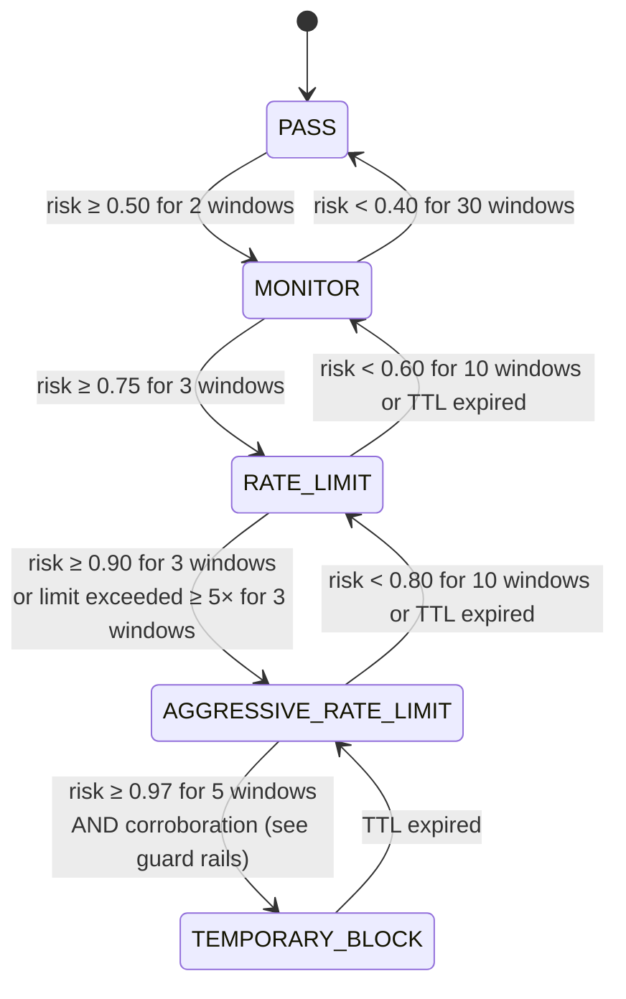

<!-- Language: **English** · [Dansk](../DK/policy-engine.md) -->

# K. Risk / policy engine

Covers requirement sections 7 (rate limiting), 8 (fast mitigation),
15 (risk engine), 16 (false-positive control) and 17 (allowlists).

The policy engine is the only component allowed to change what the
dataplane does. It turns evidence into **bounded, expiring** actions:

```
evidence (rules, baselines, models, reputation, history)
   → per-entity risk + explanation
   → action ladder with hysteresis, confidence floors, budgets
   → policy diff (with TTL) → BPF maps
```

## Entities

| Entity | Key | Typical actions |
|---|---|---|
| source | IPv4 /32, IPv6 /64 | MONITOR, SAMPLE, RATE_LIMIT, AGGRESSIVE_RATE_LIMIT, TEMPORARY_BLOCK |
| prefix | IPv4 /24, IPv6 /48 (aggregated when many sources in one prefix misbehave) | same, via the LPM map |
| service | destination prefix | protection profile: NORMAL / SUSPECT / UNDER_ATTACK |

## Evidence

| Signal | Source | Always on? |
|---|---|---|
| deterministic rules | thresholds in config (absolute caps per service/source, malformed share, bad-flag rates, SYN/ACK ratio) | **yes**, independent of ML |
| statistical baseline | robust z-scores + CUSUM ([ml.md](ml.md)) | yes (no model file needed) |
| anomaly model | Isolation Forest | if loaded |
| DDoS model | LightGBM, with attack type | if loaded |
| bot model | LightGBM per source | if loaded |
| reputation | internal offence history (decaying), operator lists, optional threat-intel feeds | yes |
| history | known-good set per service (sources with normal behaviour in the 24 h before an anomaly) | yes |

## Risk score

For each entity and window, every signal *i* yields a calibrated
probability `p_i` of "harmful", a confidence `c_i` and a weight `w_i`
(config, per service class). Signals below the confidence floor
(`c_i < 0.6`) do not contribute to escalation. The risk is a noisy-OR:

```
risk = 1 − Π_i (1 − w_i · p_i)        over signals with c_i ≥ c_min
```

Noisy-OR is used because it is monotone (more evidence never lowers
risk), bounded in [0, 1], explainable (each factor's contribution is
stored), and does not require the signals to be jointly calibrated. Every
decision stores the full contribution vector in `policy_decisions`.

Deterministic rules bypass the score: a rule sets a **minimum** action
(e.g. "source exceeds 50 k pps to a service whose absolute per-source cap
is 20 k pps → at least RATE_LIMIT at 20 k pps"). ML can raise the action
within its caps; it can never lower a rule's minimum.

## Action ladder and hysteresis



* **Separate up/down thresholds** (e.g. enter RATE_LIMIT at 0.75, leave
  below 0.60) and **consecutive-window requirements** (`k_up`, `k_down`)
  prevent flapping.
* **One level at a time**, except deterministic rules, which may jump
  straight to their minimum action.
* **De-escalation steps down**, it does not reset to PASS: a blocked
  source comes back rate-limited, then monitored.
* **Cooldown:** after a de-escalation the entity cannot re-enter the same
  level for `cooldown` (default 30 s) unless risk exceeds the entry
  threshold by a margin (+0.05).
* All thresholds are per service class
  (`[policy.service_class.<name>]`), because a DNS resolver, a game server
  and a web front end have different normal behaviour.

## TTLs

Every action carries a TTL; nothing is permanent.

```
ttl = min(base_ttl(level) × 2^offences_24h, max_ttl(level))
```

| Level | base_ttl | max_ttl (automatic) |
|---|---|---|
| MONITOR / SAMPLE | 60 s | 10 min |
| RATE_LIMIT | 60 s | 30 min |
| AGGRESSIVE_RATE_LIMIT | 60 s | 30 min |
| TEMPORARY_BLOCK | 60 s | 1 h |
| manual (API, operator) | required field | 7 d |

`offences_24h` decays: an offence older than 24 h no longer counts. While
evidence persists the engine *extends* the TTL (rewrites `expires_ns`);
when evidence stops the entry expires on its own, even if the agent is
dead, because XDP checks `expires_ns` itself.

## Guard rails against the model

ML output is untrusted input. Enforced regardless of scores:

1. **Action cap:** `ml_max_action` (default `RATE_LIMIT`) is the highest
   action reachable on ML evidence alone. `TEMPORARY_BLOCK` additionally
   requires deterministic corroboration (a rule firing for the entity) or
   agreement of two independent detectors (baseline + DDoS model) with
   confidence ≥ 0.9 for ≥ 5 windows.
2. **Shadow first:** new models start in `shadow` mode; their decisions are
   recorded with `mode = 'shadow'` and never applied.
3. **Collateral circuit breaker (per service):** if more than
   `max_known_good_drop_share` (default 1%) of the known-good sources'
   packets to a service are being dropped or limited by ML-originated
   policies, ML escalations for that service are frozen, the offending
   policies are downgraded to MONITOR, and `PolicyCircuitBreakerOpen`
   fires.
4. **Rate of change:** at most `max_new_ml_policies_per_min` (default
   10 000) new ML-originated policies per minute and at most
   `max_active_ml_blocks` (default 100 000) active ML blocks; beyond that,
   the engine prefers service-level protection over per-source entries.
5. **Map budget:** the engine never fills a policy map beyond 90%;
   low-priority entries (MONITOR/SAMPLE) are the first to be refused.
6. **Allowlist precedence:** the engine refuses to create a policy that
   overlaps an allowlist entry, and XDP checks the allowlist first anyway.
7. **Model health:** schema-hash mismatch, OOD input, latency violations or
   crashes demote the model to shadow (see [ml.md](ml.md)).

## Rate limiting

Requirement 7: packets/s, bytes/s, SYN/s, UDP packets/s, and
connections/s where observable (= SYN/s per source; completed connections
are not observable at L3/L4 without connection tracking).

Two mechanisms, chosen by *who shares the bucket*:

| | Per-source limits | Service (aggregate) budgets |
|---|---|---|
| Traffic | one source, possibly spread across all RX queues by RSS | many sources, spread evenly across queues |
| Algorithm | **GCRA** on one shared 64-bit word, compare-and-swap | **token bucket per CPU**, limit / n_rx_queues |
| Accuracy | exact | exact in expectation (law of large numbers across RSS) |
| Contention | only for rate-limited sources (few by construction) | none |
| Map | `xs_src_policy_*` value (`struct xs_gcra`) | `xs_service_state` (PERCPU_ARRAY) |

### GCRA (Generic Cell Rate Algorithm)

GCRA is the virtual-scheduling form of the leaky bucket, equivalent in
admitted traffic to a token bucket with rate `r` and burst `b`, but its
entire state is one timestamp, the *theoretical arrival time* (TAT):

```
T = 1e9 / r                 (ns per packet)
τ = T × (b − 1)             (burst tolerance)

on packet at time now:
    tat  = load(state.tat_ns)
    base = max(tat, now)
    if base − now > τ:          → nonconforming (drop); state unchanged
    new  = base + T
    if !CAS(&state.tat_ns, tat, new):
        retry once with a fresh tat
        if the retry fails too: → nonconforming
```

Why GCRA over the alternatives:

| Algorithm | State | Update from many CPUs | Problem |
|---|---|---|---|
| **GCRA** | 1 × u64 | single CAS (`__sync_val_compare_and_swap`, BPF atomics, ≥ 5.12) | none relevant |
| token bucket | tokens + last refill (2 words) | needs a lock (`bpf_spin_lock`) or a 128-bit CAS (not available) | lock per packet from every CPU |
| leaky bucket as a queue | queue | — | XDP cannot delay packets |
| fixed window counter | counter + window id | atomic add | up to 2× burst at window boundaries |
| sliding window log/counters | several counters | atomics | more memory and arithmetic for the same result |

Under contention (one rate-limited source hammering many CPUs), failing
the second CAS attempt as nonconforming is the conservative choice: the
contention itself proves the source is sending far above its limit.

**Bytes/s:** the same algorithm with increment `len × T_byte`, where
`T_byte` is stored as fixed-point 1/1024 ns so that high byte rates (e.g.
10 Gb/s → 0.8 ns/byte) are not rounded to zero. Both the packet and the
byte limiter must conform. A packet that passes the packet limiter but fails
the byte limiter has already consumed a packet slot; this slightly
under-admits, which is acceptable for a limiter.

**Classes:** `xs_policy` holds four packet limiters, one per traffic class
(`ANY`, `TCP_SYN`, `UDP`, `ICMP`), plus a byte limiter for `ANY`, so
"500 SYN/s and 5 000 UDP pps for this source" is one entry and one lookup.

### Per-CPU token bucket (service budgets)

```
state (per CPU): tokens_x1024, last_ns
rate_cpu  = budget_pps / n_rx_queues
refill    = (now − last_ns) × rate_cpu × 1024 / 1e9
tokens    = min(tokens + refill, burst_cpu × 1024)
if tokens ≥ 1024: tokens −= 1024 → conforming
else: nonconforming
```

No atomics: the state is per-CPU and only its own CPU touches it.
`n_rx_queues` is written into `xs_service_cfg` by the agent when it
configures the NIC.

### Expiry

Rate-limit policies are ordinary `xs_policy` entries and expire like any
other (`expires_ns`). GCRA state resets naturally: after idle time,
`base = now`.

## Service protection (distributed attacks)

When the coordinated-attack signal fires for a service
([ml.md](ml.md#distributed-attack-detection-14)), per-source blocking does
not scale (tens of thousands of sources, possibly spoofed). The service
moves `NORMAL → SUSPECT → UNDER_ATTACK` (with hysteresis) and the engine
installs a **protection profile**:

1. **Signature-scoped budgets:** per-CPU budgets on the attack's traffic
   class for that destination (e.g. UDP with source port 123 → service X
   limited to 3 × its baseline p99), leaving other classes untouched.
2. **Known-good first:** sources in the service's known-good set bypass the
   service budget. In XDP this is a `BPF_MAP_TYPE_BLOOM_FILTER` (≥ 5.16)
   populated by the agent before/at attack onset: one `bpf_map_peek_elem`,
   ~1% false-positive rate at 10 bits per entry.
3. **Unknown sources** share the remaining budget and get per-source GCRA
   limits if individually heavy.
4. **Optional aggressive mode** (explicit per-service config): drop the
   attack signature class entirely for sources not known-good, or enable
   `drop_fragments` for that service.

Collateral is bounded by construction: legitimate clients with history keep
full service; new legitimate clients compete with attack traffic for the
budget instead of being blocked outright.

## False-positive control (§16)

| Mechanism | Where |
|---|---|
| confidence thresholds | confidence floor per signal; confidence includes data quality and OOD checks |
| hysteresis | separate entry/exit thresholds, `k_up`/`k_down` consecutive windows |
| cooldown periods | per entity and level |
| temporary policies | every automatic action has a TTL; exponential only for repeat offenders; max 1 h |
| allowlists / trusted networks | checked first in XDP; policy creation refuses overlap |
| service-specific thresholds | `service_class` configuration |
| destination-specific baselines | baselines per service and hour-of-week |
| automatic expiry | enforced in XDP via `expires_ns`, independent of the agent |
| feedback | `POST /api/v1/feedback`: an operator-marked false positive immediately removes the policy, adds the entity to a 24 h exemption for the signals involved, and becomes a training label |
| shadow mode and circuit breaker | [guard rails](#guard-rails-against-the-model) |

No single anomalous observation can block anything: the fastest automatic
path to `TEMPORARY_BLOCK` needs sustained evidence over ≥ 13 windows
(2 + 3 + 3 + 5) and corroboration, except deterministic rules configured by
the operator.

## Allowlists (§17)

| Type | Example | Match |
|---|---|---|
| source IPv4/IPv6 addresses and CIDRs | monitoring systems, partners | LPM on source |
| management networks | `10.0.0.0/8` via the management NIC | LPM on source, `trust = full` |
| destination addresses/CIDRs | a DNS resolver that must never be touched | LPM on destination (checked in the service stage) |
| trusted services | `(dst prefix, proto, port)` never mitigated | service config flag |

Evaluation happens in XDP before any mitigation stage
([architecture.md F.2](architecture.md#f2-per-packet-pipeline-final-form-phases-15)).
Control-plane validation: CIDR syntax, no entries broader than /8 (IPv4) or
/32 (IPv6) without an explicit `force`, a mandatory comment, optional
expiry, audit log. Because source addresses can be spoofed, internet-facing
allowlist entries default to `trust = dynamic_exempt` (exempt from dynamic
policies, still subject to static caps); `full` trust is for paths where
spoofing is impossible (management NIC, uRPF-protected internal links).

## Configuration sketch

```toml
[policy]
mode = "enforce"                   # "shadow" = compute and log, never write maps
ml_max_action = "rate_limit"
confidence_floor = 0.6
max_new_ml_policies_per_min = 10000
max_active_ml_blocks = 100000
max_known_good_drop_share = 0.01

[policy.ttl]
base_s = 60
max_auto_s = 3600
max_manual_s = 604800

[policy.service_class.web]
thresholds = { monitor = [0.50, 0.40], rate_limit = [0.75, 0.60], aggressive = [0.90, 0.80], block = [0.97, 0.90] }
windows    = { up = [2, 3, 3, 5], down = [30, 10, 10, 1] }
per_source_cap = { pps = 20000, syn_pps = 500 }
weights    = { rules = 1.0, baseline = 0.6, iforest = 0.4, ddos = 0.8, bot = 0.5, reputation = 0.3 }

[[service]]
name = "www"
prefix = "203.0.113.10/32"
class = "web"
protection = "balanced"            # "off" | "balanced" | "aggressive"
```
