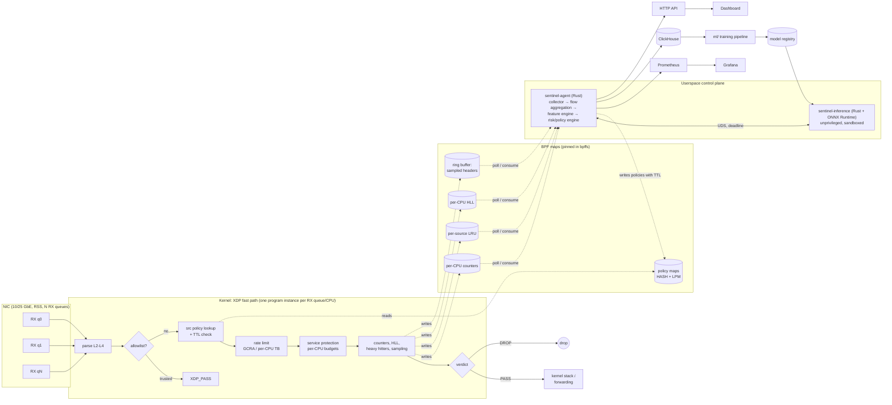
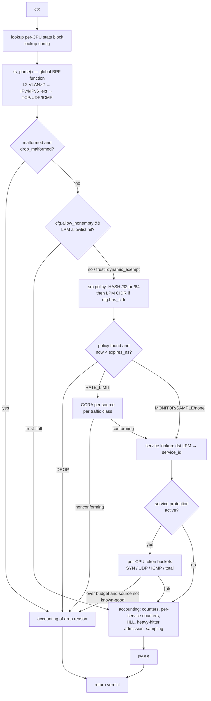
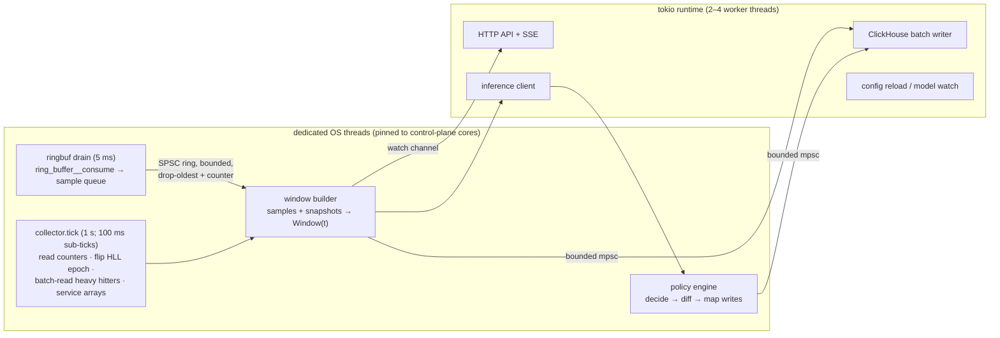

# xdp-sentinel architecture

This document is the reference design. Sections map to the requested
deliverables:

| Section | Topic | Also see |
|---|---|---|
| A | [Architecture overview](#a-architecture-overview) | |
| B | [Technology stack](#b-technology-stack) | |
| E | [Repository structure](#e-repository-structure) | |
| F | [XDP dataplane design](#f-xdp-dataplane-design) | [bpf-maps.md](bpf-maps.md) (G) |
| H | [Rust userspace architecture](#h-rust-userspace-architecture) | |
| — | [Control-plane API](#api-design) | |
| — | [Failure modes and safe defaults](#failure-modes-and-safe-defaults) | |
| C, D | Hardware, CPU/NUMA/RSS | [hardware-tuning.md](hardware-tuning.md) |
| I | Feature schema, flow key | [feature-schema.md](feature-schema.md) |
| J | ML architecture, training, deployment | [ml.md](ml.md) |
| K | Risk/policy engine, rate limiting, false-positive control | [policy-engine.md](policy-engine.md) |
| L | ClickHouse schema | [storage.md](storage.md) |
| M, N | Metrics, alerts, dashboard | [observability.md](observability.md) |
| O | Threat model | [threat-model.md](threat-model.md) |
| P | Benchmark methodology | [performance.md](performance.md) |
| Q | Roadmap, build, test | [development.md](development.md) |

---

## A. Architecture overview

### The one rule

**The packet path never waits for anything.** Every per-packet decision is
made by the XDP program from state already in BPF maps. Everything
expensive (aggregation, feature extraction, ML, policy reasoning, storage)
runs asynchronously in userspace and influences the packet path only by
writing map entries that carry their own expiry time. If all of userspace
disappears, the dataplane keeps forwarding and enforcing the deterministic
policies it already holds, and those policies expire on schedule.

### Planes



### Data flow and timing

```mermaid
sequenceDiagram
    participant X as XDP (per packet, ~100 ns budget)
    participant M as BPF maps
    participant C as collector (1 s tick)
    participant F as feature engine
    participant I as inference
    participant P as policy engine
    X->>M: counters / HLL / heavy-hitter updates (every packet)
    X->>M: ringbuf sample (1-in-N, per-CPU capped)
    C->>M: read per-CPU counters, flip HLL epoch, batch-read heavy hitters
    C->>C: drain ring buffer continuously (5 ms poll)
    C->>F: window W(t) (global, per-service, per-source)
    F->>I: feature batch + schema hash (deadline 200 ms)
    I-->>F: scores (or timeout → deterministic only)
    F->>P: features + scores + rule evidence
    P->>M: upsert / delete policies (expires_ns set on every entry)
    Note over X,M: policies take effect on the next packet;<br/>expired entries are ignored by XDP even if never deleted
```

End-to-end reaction time target: **attack onset → first mitigation ≤ 3 s**
for volumetric attacks (1 s windows, 2–3 consecutive windows of evidence),
**≤ 1 packet** for anything already covered by a static rule or an existing
policy.

### Deployment topologies

The same dataplane supports three topologies; Phases 1–16 target the first
two.

| Mode | Where XDP runs | Legitimate traffic | Use |
|---|---|---|---|
| `host` | NIC of the protected server | `XDP_PASS` to local stack | Protect services on this machine |
| `inline` | Outside NIC of a Linux router/bridge | `XDP_PASS` to kernel forwarding (optionally `bpf_fib_lookup` + `XDP_REDIRECT` fast-forwarding, see F.3) | Scrubbing box in front of a network |
| `tap` | NIC receiving a mirror/TAP | always `XDP_DROP` after telemetry | Detection only; mitigation exported (e.g. BGP FlowSpec) — design hook only |

---

## B. Technology stack

Exact choices with the reason for each. Versions are minimums that the
code is tested against; newer is fine.

### Dataplane

| Component | Choice | Why |
|---|---|---|
| Kernel | Linux ≥ 6.1 LTS; recommended 6.6 LTS / 6.12 LTS | 6.1 gives BTF, bounded loops (5.3), ringbuf (5.8), atomic fetch ops (5.12), `bpf_xdp_get_buff_len` (5.18), XDP multi-buffer (5.18). Debian 12/13, Ubuntu 22.04 HWE/24.04, RHEL 9.4+ (backports) qualify. |
| Language | C (GNU11) | Only mainstream, fully supported language for BPF with libbpf; verifier behaviour of clang output is well understood. |
| Compiler | clang/LLVM ≥ 16 (CI: 19), `-target bpf -mcpu=v3 -O2 -g` | v3 = ALU32/JMP32/atomics, fewer instructions, loads on ≥ 5.12. `-g` produces BTF. |
| Loader library | libbpf ≥ 1.1 (C tests; CI: 1.5), libbpf-rs 0.27 (vendored libbpf 1.7) | Reference implementation of BTF maps, pinning semantics, CO-RE. |
| BTF / CO-RE | `vmlinux.h` from `bpftool btf dump`, BTF-defined maps | See note below. |
| Tooling | bpftool ≥ 7 | vmlinux.h generation, introspection, `prog loadall` for verifier checks. |

**On CO-RE for XDP, honestly:** CO-RE relocations matter when a BPF program
reads *kernel* structures whose layout changes between kernels (tracing).
An XDP program reads *packet* bytes whose layout is fixed by RFCs, plus
`struct xdp_md`, which is UAPI. So the XDP program contains no CO-RE field
relocations and does not need them. What we do use from the BTF/CO-RE
toolchain: (1) BTF-defined maps (typed keys/values: `bpftool map dump`
pretty-prints them and libbpf validates pinned-map compatibility),
(2) global BPF functions, which require BTF, and (3) `vmlinux.h`, which
removes the build dependency on installed kernel headers. The object built
on one kernel loads on any ≥ 6.1 kernel without recompilation.

### Userspace

| Component | Choice | Why |
|---|---|---|
| Language | Rust (edition 2021, MSRV 1.85) | Memory safety for a privileged daemon parsing attacker-influenced data; predictable latency (no GC). |
| BPF library | **libbpf-rs 0.27** | See choice below. |
| Async runtime | tokio (multi-thread), only for network I/O: HTTP API, SSE, ClickHouse writer, inference IPC | Map polling, ring-buffer draining and aggregation run on dedicated, core-pinned OS threads: they are CPU-bound and periodic; tokio adds only scheduling jitter there. |
| HTTP | axum (hyper) | Standard; tower middleware for auth and limits. |
| Metrics | `prometheus-client` (OpenMetrics) | Typed metrics, no global registry. |
| ClickHouse | official `clickhouse` crate (RowBinary over HTTP) | Columnar binary inserts, no ORM. |
| Inference | ONNX Runtime via the `ort` crate, in a separate process | Tree ensembles and Isolation Forest exported from Python run natively; no Python in production. The `ort` 2.x API will be verified when Phase 10 is implemented. |
| Config | TOML (`serde` + `toml`, `deny_unknown_fields`) | Typed, comment-friendly, strict. |
| CLI | clap 4 | |
| Logging | `tracing`, JSON to journald | |
| Sketches | in-tree HyperLogLog and Space-Saving (~200 lines, property-tested) | Small, well-understood algorithms; avoids unmaintained crates in the control loop. |

**libbpf-rs vs aya.** Both are production quality. aya's strength is writing
the *BPF programs* in Rust with no C toolchain. Our dataplane is in C
(requirement, and the best-understood verifier behaviour), so the deciding
factor is loader fidelity: libbpf-rs wraps libbpf itself, so pinning, map
reuse, BTF handling and new kernel features behave exactly like `bpftool`
and the C test harness that validates the object (`tests/bpf`). One loader
implementation, one set of semantics. Cost: a C library (libelf, zlib) in
the build.

### ML

Python ≥ 3.11, polars (feature processing), scikit-learn (Isolation Forest,
calibration, metrics), LightGBM (primary gradient boosting; XGBoost kept as
a comparison baseline), skl2onnx + onnxmltools (export), onnxruntime
(parity tests), clickhouse-connect (data access), pydantic (schema/manifest
validation), pytest. PyTorch only if a sequence model clears the bar in
[ml.md](ml.md#when-deep-learning-is-allowed).

### Storage, telemetry, frontend

Prometheus + Grafana (operations), ClickHouse ≥ 24.x (history, features,
events), TypeScript + React (Vite SPA; see
[observability.md](observability.md#n-dashboard-architecture) for why not
Next.js).

### Deliberately not used

Kafka (a bounded in-process queue feeds ClickHouse at < 10 k rows/s), a
service mesh, Kubernetes for the dataplane (systemd on the appliance; the
dataplane must not depend on an orchestrator being healthy), Redis (all
shared state is in BPF maps or the agent), DPDK (XDP keeps the kernel stack
for legitimate traffic and needs no dedicated NIC).

---

## E. Repository structure

```
xdp-sentinel/
├── README.md
├── LICENSE, LICENSES/             per-component licensing (SPDX headers)
├── Makefile                       top-level build/test entry points
├── Cargo.toml, Cargo.lock         Rust workspace
├── rustfmt.toml
├── docs/                          this design; one file per concern
├── ebpf/
│   ├── Makefile                   clang -target bpf, vmlinux.h generation
│   ├── vmlinux.h                  generated (gitignored), from build-host BTF
│   └── src/
│       ├── xdp_main.c             entry point, stage orchestration
│       ├── abi.h                  ABI shared with userspace (counters, structs)
│       ├── compat.h               BPF vs host-test build shim
│       ├── parsers.h              L2–L4 parsers (pure, host-testable)
│       ├── maps.h                 map definitions
│       ├── telemetry.h            counters (P1); HLL, heavy hitters, sampling (P5)
│       ├── policy.h               allowlist + policy lookup (P2)
│       └── rate_limit.h           GCRA + per-CPU token buckets (P3)
├── userspace/
│   ├── common/                    ABI mirror, pin layout, snapshots (lib)
│   ├── ctl/                       sentinelctl CLI (bin)
│   ├── collector/                 map readers, ringbuf consumer (lib, P4)
│   ├── feature-engine/            windows, sketches, features (lib, P5–6)
│   ├── policy-engine/             risk engine, map writer (lib, P13)
│   ├── inference/                 sentinel-inference (bin, P10)
│   └── agent/                     sentinel-agent: composes the libs (bin, P4)
├── ml/
│   ├── feature_schema/            versioned machine-readable schema (YAML)
│   ├── datasets/                  manifests only, never raw captures in git
│   ├── training/, evaluation/     pipeline stages (python package)
│   ├── models/                    registry layout (artefacts stored outside git)
│   └── notebooks/                 exploration only; nothing imported from here
├── dashboard/                     React + TypeScript SPA
├── configs/                       development/production/example TOML (P4)
├── deploy/                        systemd units, sysctl, Grafana, alert rules
├── scripts/                       verifier stats, NIC tuning, docker dev image
├── tests/
│   ├── common/                    packet builder + shared corpus
│   ├── parser/                    host parser tests (ASan/UBSan, fuzz)
│   ├── bpf/                       in-kernel BPF_PROG_TEST_RUN tests
│   └── integration/               veth/netns end-to-end tests
└── benchmarks/
    ├── xdp/                       program-cost microbench, pktgen, RX measurement
    ├── collector/, inference/, end-to-end/
    └── results/                   recorded runs with host metadata
```

Deviations from the requested layout, and why:

* `userspace/agent/` and `userspace/ctl/` added: the listed crates are
  libraries; something has to compose them into a daemon, and operators need
  a CLI that works when the daemon does not.
* `ebpf/src/abi.h` and `compat.h` added: a single ABI header is the contract
  between C and Rust (checked by a Rust test), and the shim lets the parser
  be unit-tested on the host.
* `ebpf/vmlinux.h` is generated, not committed: it is 3–6 MB, architecture
  specific, and derived from the build host (`make -C ebpf vmlinux.h`).
* `deploy/` added to keep operational artefacts (systemd, alert rules,
  Grafana JSON) separate from source.

---

## F. XDP dataplane design

### F.1 Constraints that shape everything

* **Budget.** At 10 GbE, 64-byte frames arrive at 14.88 Mpps. Spread over
  8 RX cores that is 1.86 Mpps/core, i.e. **~540 ns per packet per core
  including the driver** (~40–60 ns on modern NICs). Design target for the
  full pipeline (Phase 3 + telemetry): **≤ 150 ns/packet** average and ≤ 6
  map operations, leaving ≥ 3× headroom at 8 cores for cache-miss-heavy
  attack traffic. Phase 1 measures ~6–10 ns of program cost on a hot cache
  ([performance.md](performance.md#phase-1-results)).
* **Verifier.** Every packet access must be dominated by a bounds check on
  the same pointer; loops need provable bounds; stack ≤ 512 B; ≤ 1 M
  verified instructions per program. Details in F.4.
* **Contention.** Anything written by all CPUs is per-CPU. Shared writable
  state is limited to entries that are rare by construction (rate-limited
  sources) and uses single-word atomics.
* **Attacker-controlled key spaces** (source addresses, ports, flows) never
  allocate unbounded state: tables keyed by them are LRU,
  admission-controlled, and sized by the control plane.

### F.2 Per-packet pipeline (final form, Phases 1–5)



Ordering rationale:

1. **Parse first**, because every later stage keys on parsed fields and
   parse outcome counters must be exact.
2. **Allowlist before policy**: an operator allowlist overrides any dynamic
   decision (protects management access from a bad model or a poisoned
   policy). It is an LPM lookup, skipped entirely (one config bit) when the
   allowlist is empty. Allowlisted traffic still goes through accounting so
   baselines include it.
3. **Exact-match policy before LPM**: >99% of dynamic policies are single
   sources; a HASH lookup is O(1) and cheaper than a trie walk. The LPM
   trie (static CIDR rules) is consulted only if any exist (config bit).
4. **Per-source limits before service budgets**, so a single abusive source
   is charged to its own bucket and does not consume the service's shared
   budget.
5. **Accounting last**, so counters see the final verdict and drop reason.

### F.3 Verdicts

| Verdict | Used for | Notes |
|---|---|---|
| `XDP_PASS` | default; legitimate traffic | |
| `XDP_DROP` | DROP policies, nonconforming rate-limited traffic, validity drops | Cheapest possible action |
| `XDP_TX` | reserved: XDP SYN proxy (SYN cookies answered in XDP via `bpf_tcp_raw_gen_syncookie_ipv4/ipv6`, Linux ≥ 5.10) | Justified only for inline mode protecting servers that cannot run SYN cookies themselves; in `host` mode the kernel already has SYN cookies. Optional Phase 15+ item, gated on benchmark evidence. |
| `XDP_REDIRECT` | reserved: inline fast-forward via `bpf_fib_lookup` + DEVMAP | Only if benchmarks show kernel forwarding of *legitimate* traffic is the bottleneck. Legitimate 10 G traffic is mostly large packets (IMIX ≈ 3.3 Mpps), which kernel forwarding handles on 4–8 cores. |
| `XDP_ABORTED` | never returned deliberately | Would indicate a program bug; visible via the `xdp:xdp_exception` tracepoint. |

Policy actions (control-plane vocabulary, see
[policy-engine.md](policy-engine.md)): `PASS`, `MONITOR` (count and flag in
telemetry), `SAMPLE` (raise this source's sampling rate), `RATE_LIMIT`,
`AGGRESSIVE_RATE_LIMIT` (same mechanism, tighter parameters),
`TEMPORARY_BLOCK` (= `DROP` with TTL). There is no permanent dynamic block:
every dynamic entry carries `expires_ns`; static operator rules live in a
separate, explicitly managed map.

### F.4 Parser and verifier constraints (implemented in Phase 1)

`ebpf/src/parsers.h`. What the verifier demands and how the code satisfies
it:

| Constraint | Consequence in the code |
|---|---|
| Packet loads only within `[data, data_end)` proven by a comparison on the same pointer lineage | Every header is read through `hdr` after `if ((void *)(hdr + 1) > data_end) return ERR`. Variable-length headers are checked again after the variable advance. |
| Variable offsets added to packet pointers must be bounded, and `umax + fixed_off ≤ 0xFFFF` for a check to establish a readable range | IHL/doff are masked (`& 0x0F`, `>> 4`) and multiplied, giving provable bounds ≤ 60. The IPv6 extension walk uses a scalar offset masked with `0x3FFF`. |
| The verifier (at least through 6.12) does **not** track value ranges through the `BPF_END` byte-swap instruction | `xs_ntohs_bounded()` re-masks after `bpf_ntohs()` behind an empty `asm volatile`, because clang would otherwise delete the "redundant" mask. Found by loading the object: `value … makes pkt pointer be out of bounds`. |
| Loops need provable bounds; state explosion counts against the 1 M instruction budget | VLAN (2) and IPv6 extension-header (6) loops have constant trip counts and are unrolled. The extension loop re-bounds its offset each iteration so every iteration starts in the same verifier state (prunable): 40 k → 26 k verified instructions. |
| Path explosion multiplies across the whole program | The parser is a **global** (non-static, `__noinline`) BPF function `xs_parse(ctx, pkt)`, verified once, independently; the caller sees opaque results. Phase 1: **603 k** verified instructions fully inlined vs **26 k** split (2.6% of the limit, ~75 ms). |
| Stack ≤ 512 B | `struct xs_pkt` is 64 B; total stack depth 64 B. |
| Subtracting packet pointers requires `CAP_PERFMON` | Only `data_end - data` for byte counts; the loader holds `CAP_BPF + CAP_PERFMON + CAP_NET_ADMIN`. |
| Unaligned loads | Headers after a 14-byte Ethernet header are 2-byte aligned. Fine on x86-64/arm64 (the verifier only rejects under `BPF_F_STRICT_ALIGNMENT`); structs are not `packed`, because clang would then emit byte-by-byte loads. |

Handled inputs: Ethernet II and 802.3 length frames; 802.1Q, 802.1ad and
0x9100 tags up to two deep (three or more → `UNSUP_VLAN_DEPTH`, passed);
IPv4 with options, fragments (first/later), tiny first fragments
(RFC 1858), total length vs frame (Ethernet padding allowed); IPv6 with
HBH/routing/destination-options/fragment/AH chains up to 6 headers, atomic
fragments (RFC 6946), payload-length validation, extension chain vs payload
length; TCP data-offset bounds and flag sanity; UDP length vs IP payload;
ICMP/ICMPv6 minimum length; LAND (src == dst). Every frame yields exactly
one of 24 parse outcomes, counted per CPU, so `Σ parse outcomes == rx` is
an invariant checked by the tests.

**Classification:** `ERR_*` = malformed per RFC, a drop candidate *only if
the operator enables `drop_malformed`*. `UNSUP_*` = legal but beyond the
fast path, **always passed** (RFC 7045: middleboxes must not drop what they
do not understand). Default config is all-zero = observe only.

**NIC VLAN offload:** with `rxvlan` offload on (default on most NICs), the
NIC strips the outer tag before XDP sees the frame; the tag is only
reachable through the `bpf_xdp_metadata_rx_vlan_tag` kfunc (Linux ≥ 6.8,
driver dependent). If VLAN-aware policy is needed, disable `rxvlan`
([hardware-tuning.md](hardware-tuning.md#offloads)).

**MTU:** the program is `SEC("xdp")` (single buffer), so the kernel refuses
attachment when the MTU needs multi-buffer XDP (roughly > 3 KB, driver
dependent), and `[data, data_end)` is always the whole frame. Jumbo frames
need an `xdp.frags` build that uses `bpf_xdp_get_buff_len()`; planned, not
in Phase 1.

### F.5 What is computed in XDP vs userspace

| In XDP (per packet, exact or sketch) | In userspace (per window) |
|---|---|
| parse outcome, protocol, TCP flag class counters | rates, ratios (SYN/ACK), acceleration |
| per-service packets/bytes/SYN/UDP/ICMP (per-CPU arrays, exact) | per-service baselines, z-scores |
| per-source counters for admitted heavy hitters (LRU) | per-source feature vectors, top-K |
| HyperLogLog registers: distinct src, dst, dport, 5-tuple (per-CPU, epoch-flipped) | cardinality estimates, new-flow rate |
| per-destination-port packet histogram (per-CPU array, 65 536 slots) | port entropy, port concentration |
| 1-in-N sampled headers → ring buffer (per-CPU capped) | entropy, packet-size percentiles, TTL spread, inter-arrival stats, flow reconstruction |
| policy enforcement | everything else |

Rule of thumb: XDP does **fixed-cost, mergeable** operations (increment,
register max, bitmap OR). Anything that needs division, logarithms,
sorting or history happens in userspace.

### F.6 Flow key and state

A full 5-tuple flow table in XDP is deliberately **not** kept: a spoofed
flood creates one flow per packet (14.88 M/s), which would thrash any table
and make per-packet cost depend on attacker behaviour. Instead:

* distinct-flow **counts** come from a per-CPU HyperLogLog over the 5-tuple
  (fixed cost, ~1.6% error);
* **per-source** state exists only for sources admitted by probabilistic
  admission ([bpf-maps.md](bpf-maps.md#10-per-source-heavy-hitter-table));
* **flows** are reconstructed in userspace from sampled headers; memory and
  CPU there are bounded by the sampling cap, not by the attack.

Flow-key definition and memory arithmetic:
[feature-schema.md](feature-schema.md#flow-key).

### F.7 Program structure and upgrades

One XDP program per interface, one `.o`, one entry point, stages as
`static __always_inline` functions, with global functions only at
verification boundaries (the parser today; possibly the policy stage
later). No tail calls: each costs an indirect jump, they complicate the
verifier picture, and the pipeline fits in one program. Upgrades use
`XDP_FLAGS_REPLACE` (atomic, no unprotected window) with pinned maps
reused, so counters, config and policies survive (validated by
`tests/integration/veth_smoke.sh`).

---

## H. Rust userspace architecture

### Processes

| Process | Privileges | Role |
|---|---|---|
| `sentinel-agent` | `CAP_BPF`, `CAP_PERFMON`, `CAP_NET_ADMIN` as systemd `AmbientCapabilities` for a dedicated user | Loads/attaches the dataplane; collector, feature engine, policy engine, map writer, API, metrics, ClickHouse writer |
| `sentinel-inference` | none; `DynamicUser=yes`, no network, read-only model directory, seccomp filter | Loads ONNX models, scores feature batches received over a Unix socket |
| `sentinelctl` | caps for attach/detach; read access to pins for stats | Emergency operations that must work without the agent |

Why inference is a separate process: ONNX model files are complex, parsed
by a large C++ runtime, and an obvious poisoning/exploitation target.
Isolating that parser from the only process holding `CAP_BPF` means a
malicious model can at worst produce bad scores, which the policy engine
already treats as untrusted and bounded
([policy-engine.md](policy-engine.md#guard-rails-against-the-model)). It
also turns an inference crash or hang into a *timeout*, not an agent
outage.

### Threads inside sentinel-agent



Design rules:

* **Every queue is bounded** and has an explicit overflow policy and a
  metric. Nothing upstream of the policy engine ever blocks on ClickHouse,
  Prometheus scrapes or the dashboard.
* **Low copy:** ring-buffer records are fixed-size 64-byte structs decoded
  field-by-field from the borrowed slice libbpf's consume callback provides,
  into a preallocated slab; per-CPU snapshots decode into buffers reused
  every tick; aggregation tables (`hashbrown` + `ahash`) are cleared, not
  reallocated, between windows.
* **Time:** the dataplane uses `bpf_ktime_get_ns()` (CLOCK_MONOTONIC); the
  agent converts TTLs to monotonic deadlines with
  `clock_gettime(CLOCK_MONOTONIC)`, never wall clock, so NTP steps cannot
  expire or extend policies.
* **Single writer:** only the policy-engine thread writes policy maps. It
  keeps an in-memory mirror, computes a diff each cycle and applies it with
  batch updates (`bpf_map_update_batch`), rate-limited (default ≤ 50 k
  updates/s) so a runaway decision loop cannot saturate the kernel.
* **Restart safety:** on start the agent reads the pinned policy maps back
  into its mirror (source of truth = kernel), so a restart neither drops nor
  duplicates mitigations.
* **Unsafe:** confined to libbpf-rs and a few `libc` calls with
  `// SAFETY:` justifications (`clippy::undocumented_unsafe_blocks = deny`).

### Crates

`common` (ABI, pins, snapshots — done), `ctl` (done), `collector` (map
readers, ringbuf, epoch management), `feature-engine` (windows,
HLL/Space-Saving, entropy, feature vectors, schema hash), `policy-engine`
(rules, risk, hysteresis, TTL, budgets, map writer), `inference` (bin),
`agent` (bin).

---

## API design

Served by `sentinel-agent` on a management address (default
`127.0.0.1:9477`; production behind an mTLS/OIDC reverse proxy). JSON,
versioned under `/api/v1`. Mutating calls require the `operator` role, are
validated (CIDR syntax, allowlist overlap, TTL bounds, budgets), idempotent
via a client-supplied `request_id`, and written to an audit log (journald +
ClickHouse `audit_log`).

| Method | Path | Purpose |
|---|---|---|
| GET | `/healthz`, `/readyz` | liveness / readiness (dataplane attached + collector ticking) |
| GET | `/metrics` | Prometheus/OpenMetrics |
| GET | `/api/v1/status` | interfaces, attach mode, prog ids, kernel, component and model versions |
| GET | `/api/v1/traffic/current` | last window: pps, bps, protocol mix, drops by reason |
| GET | `/api/v1/traffic/top?dim=src\|dst\|dport\|service&n=50&window=10s` | top-K from heavy hitters |
| GET | `/api/v1/stream` | SSE, one message per window (dashboard live view) |
| GET | `/api/v1/policies?action=&src=&limit=&cursor=` | active dynamic policies (from the mirror) |
| POST | `/api/v1/policies` | manual policy `{target, action, rate?, ttl_s, reason}`; TTL mandatory, ≤ 7 d |
| DELETE | `/api/v1/policies/{id}` | remove (records operator and reason) |
| GET/POST/DELETE | `/api/v1/allowlist` | `{cidr, trust: full\|dynamic_exempt, comment, expires?}` |
| GET | `/api/v1/services` | protected services and their current state |
| GET | `/api/v1/events?from&to&type&src&dst&cursor` | security events (ClickHouse-backed) |
| GET | `/api/v1/attacks?from&to` | attack episodes |
| POST | `/api/v1/feedback` | `{event_id, label: false_positive\|true_positive, note}` |
| GET | `/api/v1/models` | registry: active/candidate versions per model |
| POST | `/api/v1/models/{name}/activate` | `{version, mode: shadow\|enforce}`; rollback = activate previous |
| GET/PUT | `/api/v1/config` | full config document with `version`; PUT validates and swaps atomically, rejecting unknown fields |

Agent ↔ inference IPC: Unix stream socket, length-prefixed frames.
Request: `{proto_version u16, schema_hash [u8;32], model u8, rows u32,
cols u16, deadline_ms u16, f32 row-major matrix}`. Response: `{status,
model_version, scores f32 × rows × k}`. A schema-hash mismatch is an error,
never a silent misalignment of feature columns.

---

## Failure modes and safe defaults

The dataplane's behaviour in every failure is determined by what is already
in the maps; no failure below changes verdicts for traffic that no policy
matches.

| Failure | Dataplane | Control plane | Signal |
|---|---|---|---|
| ML/inference crashes, hangs, or model missing | unchanged | requests time out after `deadline_ms`; policy engine runs deterministic rules + statistical baseline only; ML-driven escalations stop; existing ML policies expire on their TTL | `xs_inference_up=0`, `xs_inference_timeouts_total`, alert `InferenceDown` |
| Agent/collector crashes | unchanged: program stays attached (netlink attachment owned by the netdev), pinned maps keep counters and policies, policies still expire in XDP via `expires_ns` | systemd restarts the agent (`Restart=always`), which re-reads pinned maps | alert `AgentDown` (`up == 0`) |
| ClickHouse down/slow | unchanged | writer buffers ≤ 60 s / 200 MB, then drops oldest batches with a counter; detection unaffected | `xs_clickhouse_dropped_rows_total` |
| Prometheus down | unchanged | none (pull model) | external blackbox alert |
| Ring buffer overflow | reserve fails → sample skipped, drop counter incremented; verdict unaffected | counter/sketch features remain exact; sample-derived features flagged lower confidence | `xs_ringbuf_drops_total`, alert `RingbufLoss` |
| Per-source LRU full | LRU evicts; admission keeps churn bounded | heavy hitters stay (constantly touched) | eviction estimate metric |
| Policy map full | `update` fails in userspace, never in XDP | policy engine escalates to CIDR/service-level mitigation, refuses new low-priority entries | `xs_policy_map_full_total`, alert |
| CPU saturation on RX cores | NIC drops at the ring (`rx_missed`/`rx_dropped`); XDP never queues | alert; operator adds queues/cores or enables stricter service protection | `xs_nic_rx_missed_total`, softirq % |
| Traffic > 10 Gbps | the link is the bottleneck; only upstream mitigation (RTBH/FlowSpec, provider scrubbing) helps | attack event records it | link-utilisation alert |
| Invalid configuration | unchanged (last good config stays in maps) | rejected at parse/validate; the agent never detaches a running dataplane because of config | `xs_config_reload_failures_total` |
| Verifier rejects a new program on upgrade | old program keeps running (`REPLACE` happens only after a successful load) | upgrade fails loudly | exit code, log |

**Safe defaults** (Phase 1 already behaves this way): all drop flags off;
new policy maps empty; ML models start in `shadow` mode (decisions logged,
not enforced); `ml_max_action = RATE_LIMIT`; every dynamic action has a TTL
(default 60 s, max 1 h automatic, 7 d manual); aggressive modes are explicit
per-service config switches.
