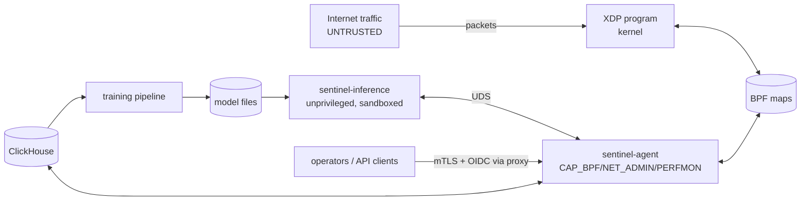

# O. Threat model of the appliance itself

The appliance sits in the path of hostile traffic and holds the power to
drop legitimate traffic, which makes it both a target and a weapon.

## Assets

1. **Availability of protected services**, including against the
   appliance itself wrongly dropping legitimate traffic.
2. **Integrity of the dataplane**: the XDP program and its maps (policies,
   allowlists, config).
3. **Integrity of decisions**: models, feature pipeline, training data,
   labels.
4. **Availability of the appliance's management and telemetry path.**
5. Confidentiality of telemetry (addresses and traffic metadata are
   personal data in many jurisdictions).

## Trust boundaries

Everything left of XDP is hostile. Model files, training data and labels
are *semi-trusted*: produced by us, but influenced by traffic an attacker
controls.

## Threats and mitigations

| # | Threat | Mitigation | Residual risk |
|---|---|---|---|
| 1 | **Malicious / malformed packets** crash or confuse the parser | Verifier-proven memory safety; every length field bounded and validated; 24-way parse outcome classification; host fuzzing (truncations + bit flips under ASan/UBSan) and in-kernel corpus tests (Phase 1) | Logic bugs in classification (tests cover the corpus, not all inputs) |
| 2 | **Parser evasion**: attack traffic hidden behind VLAN stacks, IPv6 extension chains, fragments | Unsupported depths are counted (`parse_unsup_*`) and visible; `drop_fragments` per service under attack; tiny first fragments flagged (RFC 1858); extension-chain limit (6) above real-world usage | Traffic beyond parse depth is passed (by design, RFC 7045); it is visible in counters and can be rate-limited as a class |
| 3 | **Map exhaustion**: attacker fills per-source or flow tables | Attacker-keyed tables are LRU with probabilistic admission (≤ pps/1024 inserts); policy tables are control-plane-only HASH with budgets; no per-flow table in XDP | Heavy-hitter table churns under huge botnets (accuracy loss, no failure) |
| 4 | **Flow-table exhaustion in userspace** | Flow reconstruction fed by capped samples; hard capacity + LRU; bounded queues | Reduced flow visibility under extreme source counts |
| 5 | **CPU exhaustion** (per-packet cost, cache-miss floods) | Fixed per-packet work (no data-dependent loops beyond fixed bounds); ≥ 2.5× core headroom; RSS on ports; NIC drop counters alert; Phase 16 benchmarks with random-source floods | Link or NIC saturation beyond 10 G is only solvable upstream |
| 6 | **Telemetry flooding** (make the sampler/ring buffer the bottleneck) | Per-CPU sample token bucket; `BPF_RB_NO_WAKEUP`; loss counted, never blocking; features degrade to counter/sketch-based with lower confidence | Sample-derived features less accurate during extreme floods |
| 7 | **Userspace compromise** of the agent | Least privilege: dedicated user, ambient caps only `CAP_BPF`, `CAP_PERFMON`, `CAP_NET_ADMIN`; systemd hardening (`ProtectSystem=strict`, `NoNewPrivileges`, `SystemCallFilter`, `RestrictAddressFamilies`); Rust; no model parsing in this process; API on management network only | An agent compromise controls the dataplane (inherent: it is the control plane) |
| 8 | **Compromise via model files** (parser exploits in ONNX Runtime) | Inference in a separate unprivileged, sandboxed process (DynamicUser, no network, read-only model dir, seccomp); model files hash-verified against the signed manifest | A malicious model can still emit bad scores → bounded by guard rails (#10) |
| 9 | **Policy injection** via API | mTLS/OIDC at the proxy; operator role for mutations; strict validation (types, CIDR syntax, TTL bounds, allowlist overlap, entry budgets); audit log; `deny_unknown_fields` config parsing; idempotency keys | A stolen operator credential can create policies (bounded by TTL ≤ 7 d and audit) |
| 10 | **Model poisoning**: attacker shapes traffic so future training learns attacks as normal, or makes normal look malicious | Training excludes windows under active mitigation and unlabelled attack episodes; labels from feedback need operator role and are audited; time-split evaluation with fixed test gates; shadow period before enforcement; ML action cap (`RATE_LIMIT` by default); collateral circuit breaker; deterministic protection independent of ML | Slow drift attacks over months could shift baselines; mitigated by baseline windows (4 weeks) and review of baseline growth |
| 11 | **Adversarial evasion** (traffic crafted to look normal to the model) | Models are one input among several; deterministic caps (absolute per-source and per-service budgets) do not depend on model judgement; service protection profiles limit aggregate impact regardless of classification | A perfectly mimicked flood below per-source caps from many sources is bounded only by service budgets |
| 12 | **Spoofed source addresses** | Service-level (destination-centric) mitigation does not rely on source identity; per-source blocks have short TTLs (spoofed victims recover); allowlisted internet-facing sources are `dynamic_exempt`, not `full` trust; TTL and prefix diversity features detect spoofing | Reflection victims of our own blocks (an attacker spoofing a partner's address) → allowlist partners, short TTLs |
| 13 | **Self-DoS via false positives** | Hysteresis, confidence floors, TTLs, known-good-first, circuit breaker, shadow mode, safe defaults (observe-only dataplane config) | Misconfigured deterministic rules (operator error) → config validation + dry-run mode |
| 14 | **Time manipulation** (NTP) to expire or extend policies | Dataplane and agent use CLOCK_MONOTONIC for all TTLs | none known |
| 15 | **Management plane unreachable during attack** | Separate management NIC; management networks allowlisted with `full` trust on that NIC only | Out-of-band access still recommended (BMC) |
| 16 | **Loader/upgrade failure leaves interface unprotected** | Atomic `XDP_FLAGS_REPLACE` only after successful load; `UPDATE_IF_NOEXIST` prevents clobbering; pinned maps reused | — |
| 17 | **Supply chain** (crates, Python packages, base images) | `Cargo.lock` committed, `cargo deny` / `cargo audit` in CI, pinned Python requirements with hashes, reproducible dev container | Standard ecosystem risk |
| 18 | **Telemetry confidentiality** | ClickHouse on management network with TLS; least-privilege DB users; TTLs on all tables (≤ 400 days, raw samples 3 days, off by default) | Retention policy must match local law |

## Principles derived from the model

* **Never trust packet fields** for anything except classification;
  lengths are validated, never used unbounded.
* **Validate all control-plane input** at the API boundary and again at
  the map-writer boundary (the writer rejects entries without TTL or
  overlapping allowlists, whatever the caller).
* **Bound everything:** every table, queue, rate, TTL and ML-driven action
  has a limit and a metric.
* **Fail open for availability, closed for privilege:** a broken control
  plane stops mitigating (policies expire); it never starts dropping.
